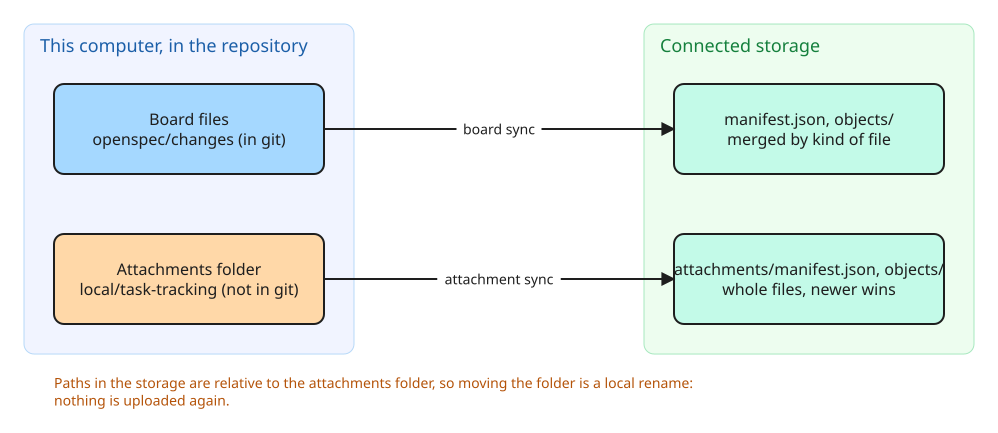

# Attachments: sync through the connected storage, and move with their folder, 12 Nov 2026

- **Status:** started 2026-11-12; chunks `engine` and `folder` running, `wiring` after them
- **Date:** 2026-11-12
- **Author:** Claude (agent)
- **Work items:** the attachments item filed with this plan; builds on #wi160

## Why

"what about assets? can i store them there too? what happens when location is changed within the app? does it move assets to the new location?" Then: "implement".

Today pasted images and attached files live in `local/task-tracking/` (kept out of git) and are not synced: a note arrives on the second computer with a link to a picture that is not there. Changing the attachments folder in Settings only changes where new files go; existing files stay and nothing is rewritten. The folder setting is per computer.

## What the industry does

From the research for #wi160 (sources in `board-sync-through-blob-storage-2026-11-12.md`):

- Joplin syncs each attachment ("resource") as its own item beside the notes, never merged.
- Obsidian Sync merges markdown and uses last-modified-wins for every other file.
- rclone and Syncthing treat binary files whole; the loser of a clash is kept as a copy.

## Design

- **A second sync beside the board's**, same engine, same storage, under the prefix `attachments/` (its own manifest and objects; the board's layout is untouched, nothing migrates). Its own state folder on each computer.
- **Whole files, never merged.** When both computers changed the same attachment, the newer one wins and the other is kept in the trash, like any file a sync replaces.
- **Paths are relative to the attachments folder** (`wi12/n5/pic.png`), so the folder's name and place can differ or change without anything being uploaded again.
- **A file over the size cap (64 MB) is skipped and reported**, it does not fail the sync.
- **No git rules**: attachments are not in git, so every local change is an edit and there is no pause for merges.
- **Deletions, the trash, the 24-hour brake, the approval step and the path and link safety rules** apply as for the board.
- **A switch per project**, "Sync attachments too", on by default once a storage is connected and approved; saved with the project's settings. Off: attachments stay on the computer.
- **The attachments folder becomes a project setting** (in the repository's `openspec/config.yaml`, where the storage address is), so every computer uses the same one. A value a user had set per computer is read until the project has one.
- **Changing the folder moves the files**: the app asks, moves every file from the old folder to the new one without overwriting, and rewrites the paths in notes (their attachment lists and bodies) and in descriptions. When the change arrives from another computer (the setting through git, the rewritten notes through sync), the app moves this computer's files by itself and says so.

## Decisions

- **Attachments sync is a second sync, not part of the board's.** The board's root is in git and has merge and git rules; attachments have neither. Two manifests keep the rules separate and the board's layout stable.
- **Whole-file rule by option, not by file name.** An attached `.md` or `events.log` must not be merged as board text.
- **On by default with a switch.** The owner asked for attachments in the storage; the switch is for projects where they should stay private. The approval step already gates any sync.
- **Old versions are never cleaned from the storage** (as for the board). Screenshots are bigger than board files: a clean-up of old objects becomes worth doing sooner; not in this item.

## Chunks

| Chunk | What | Owner | Test |
|---|---|---|---|
| engine | A storage view under a prefix; a whole-files option; oversized files skipped and reported | sonnet, worktree | `SyncingAttachmentsTests` |
| folder | The folder as a project setting; moving files and rewriting paths; the question in Settings | sonnet, worktree, port 9601 | `MovingAttachmentsTests`; hidden desktop |
| wiring | The app runs the attachments sync beside the board's, the switch, the state line, the automatic move when the folder changed elsewhere | after both, port 9602 | new facts in `SyncingWithConnectedStorageTests`; hidden desktop, two demo repositories |

## Verification

- Fast suite and CLI suite green after each integration (baseline 872 and 15).
- Hidden desktop, light and dark: the move question and its result; an image pasted on one "computer" showing on the other.
- Not possible here: a real R2 bucket; large files over a slow link.
