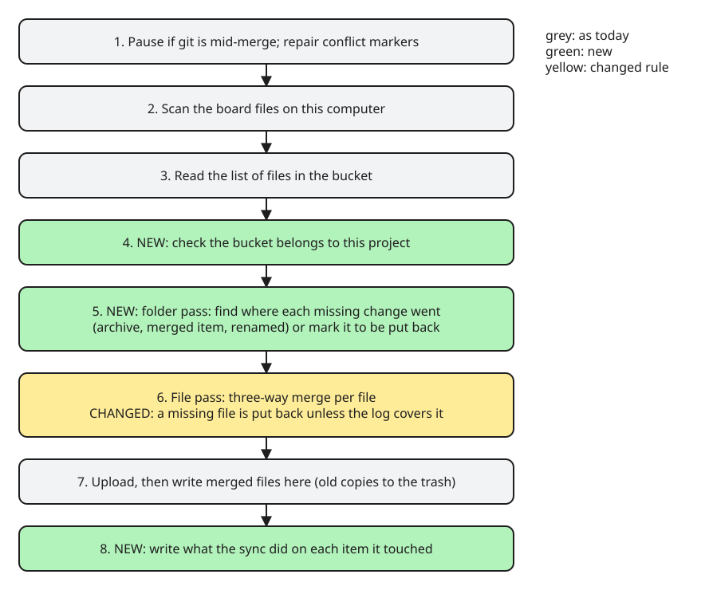
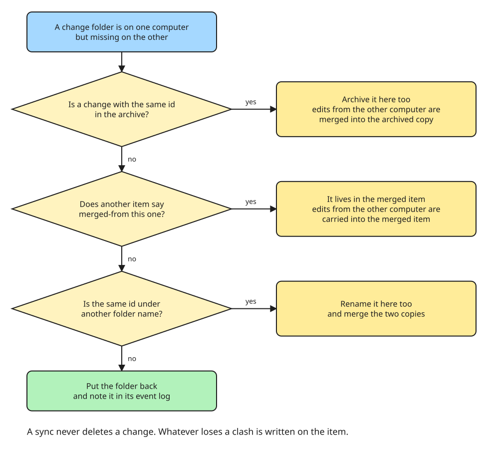

# Board sync that follows OpenSpec's rules: nothing is deleted (#wi233)

Status: done 2026-11-26 — chunks 0 and A–E plus three fixes integrated and staged; regression 1512 passed, 0 failed; the seven scenarios verified in the real app (#233 In Review). Follow-ups: #234 (half-uploaded folder on a stopped settle window), the watcher adding outside edits to the app-edit set, the "Nothing new" state line after a refill

Research: `DevResources/plans/git-event-log-sync-research-2026-11-26.md` (68 sources). Amends `board-sync-through-blob-storage-2026-11-12.md`: same bucket, same three-way merge, new rules for missing files and folders.

## Why

On 2026-11-26 the sync of the var density board paused: "This sync would delete 48 of 77 board files on this computer". Nobody deleted anything.

The sync compares three lists of file paths (this computer, the bucket, the last sync) and reads every path that is missing as a deletion (`BoardSync/Sync/SyncPlanner.cs:209-221`, `:237-262`). That is how general file-sync tools work, and it is wrong for this board.

Owner, 2026-11-26:
- "openspec does not do deletion, it is incremental"
- "task merges are not deletions"
- "you have git to track changes. use it for three way merge as you already do. the only problem i have with you is you are not respecting openspec principles with this"
- "you also need to account for merge conflicts" and "what about event log"
- "i dont want to be managing yet another git shit" (so: no new git ref, no new remote; the bucket stays)

## The OpenSpec rules the sync must follow

1. A change is a folder: `openspec/changes/<folder>/`. Its identity is its id (`x-rtm.id` in `.openspec.yaml`), not its path.
2. A change is only ever added to. Its files gain content; its event log gains lines.
3. A completed change moves to `openspec/changes/archive/<date>-<folder>/`. That is a move, not a deletion.
4. This app adds two more moves: a merge of items (the sources' content goes into a new item, which records `mergedFrom` and `mergedFolders`), and a folder rename to a free name.
5. Nothing else makes a change disappear. A folder that is gone with none of 3 or 4 behind it was not deleted; it is missing and has to come back.

## The design in one paragraph

The bucket, the per-file three-way merge and the use of git stay as they are. Before the sync compares files, it now looks at whole change folders by id: a folder missing on one side is looked up in the archive, in the merged items and under other folder names, and the sync follows it there, merging in any edits the other computer made meanwhile. A folder or file that is missing with no such explanation is put back. The sync writes what it did on the item's event log. It deletes nothing.

## The folder pass (new)

Runs after the scan and the read of the bucket's list, before the per-file plan.

**Input.** Three views of `openspec/changes`: this computer (L), the bucket's manifest (R), the saved base of the last sync (B).

**Index.** For each view, a map from id to folder, read from each folder's `.openspec.yaml`: `x-rtm.id`, `x-rtm.mergedFrom`, `x-rtm.mergedFolders`. For the bucket, only the `.openspec.yaml` objects whose hash differs from the base are fetched (small files; cached by hash in the pass).

**For every change folder F that the base has and one side lacks** (no live file under F on that side), resolve it on the side that lacks it, in this order:

| Order | Check on the side that lacks F | Result |
|---|---|---|
| 1 | a folder under `archive/` has the same id | **Archived**: F moved to that folder |
| 2 | a folder's `mergedFrom` holds F's id (and `mergedFolders` holds F's name, when the field exists; older merges: a `merged-from #<id>` line in its `events.log`) | **Merged**: F's content lives in that item |
| 3 | a folder outside the archive has the same id under another name | **Renamed**: F moved to that folder |
| 4 | none | **Missing**: F is put back |

**What each result does**

- **Archived or Renamed, F → D.** Every file `F/x` is paired with `D/x`.
  - The side that still has `F/x` unchanged since the base: the old copy goes to the trash here (or gets its marker in the bucket), and `D/x` arrives as a normal download or upload.
  - The side that still has `F/x` **edited** since the base: a three-way merge of (its `F/x`, the base `F/x`, the other side's `D/x`) with the existing per-file rules; the result is written to `D/x` on both sides.
  - A file that exists only under F (a note written meanwhile): it is moved to `D/` and uploaded there.
- **Merged, F → Z.** The side that still has F unchanged: its old copy goes to the trash. If it edited F since the base, the edits are carried into Z:
  - `events.log`: lines the base did not have are added to Z's log, marked `| from #wi<id>` as the merge itself does.
  - a new note: copied into `Z/notes/` with `mergedFrom` and `mergedAt` set, as the merge does; its id is checked against Z's notes and renumbered if taken.
  - an edited note: three-way merge with Z's copy of that note.
  - `tasks.md`: added and ticked subtasks are applied to that item's group in Z (`#wi<id> Title · merged <date>`), subtask by subtask.
  - `.openspec.yaml`: list fields (commits, docs, tests, contributors) are added to Z's lists. A changed title, status, priority, label or date is **not** applied: Z has its own. It is written as one note in Z.
  - `proposal.md` or a delta spec edited: written as a note in Z with the new text ("#wi<id> was edited on another computer after the merge").
- **Missing.** If this computer lacks F, its files are downloaded. If the bucket lacks F (marked deleted, or not listed at all), its files are uploaded again as live entries.

**Both sides moved F.** Nothing to do for F itself. The destinations are then compared by id:
- both archived it, on different days: two archive folders with one id. The one with the earlier date is kept; the other's files are merged into it file by file, and its folder goes to the trash.
- one archived, one merged, or merged into two different items: both destinations are kept. Each gets a note naming the other ("#wi<id> was also merged into #wi<n> on another computer"). No winner is picked.

## The file rule (changed)

For a file that the base has and one side lacks, inside a folder that exists on both sides:

- It is removed on the other side **only** if the item's event log, on the side that lacks the file, has a line newer than the base that covers it:
  - `renumbered | #n12 -> #n15 …` covers `notes/n12.md`
  - `converted | note #n12 -> subtask 2.3` covers `notes/n12.md` when the conversion removed the note
  - `spec-removed | specs/<capability>/spec.md` (new event)
  - `spec-moved | specs/<old> -> specs/<new>` (new event)
- Otherwise the file is put back: downloaded here, or uploaded again.

Markers in the bucket's list (`deleted: true`) are written only for removals that a move or one of these lines explains. A marker that nothing explains, left by the old rule, is ignored: the file is kept here and uploaded again. That is what repairs boards the old rule already damaged.

Everything else in the file pass stays: event logs are joined line by line, `.openspec.yaml` merges by field, `tasks.md` by subtask, notes by field and text, other markdown by text, the newer side wins a real clash and the loser is recorded on the item (`BoardSync/Merge/FileMerge.cs:44-58`).

## Conflicts: every case and its outcome

| # | What happened | Outcome |
|---|---|---|
| 1 | Both computers edited the same file | Per-file merge as today; the newer edit wins a clash; the loser is written on the item as a `sync-conflict` event or a note |
| 2 | One archived the item, the other edited it | The edits are merged into the archived copy; no active copy comes back |
| 3 | One merged the item into another, the other edited it | The edits are carried into the merged item (list above); what cannot be applied is a note there |
| 4 | Both archived the same item on different days | One archive folder (the earlier date); the other is merged into it |
| 5 | The same item was merged into different items on two computers | Both merged items stay; each gets a note naming the other |
| 6 | One archived it, the other merged it | Both stay; each gets a note naming the other |
| 7 | Both created an item or note with the same id | As today: one is renumbered and a `renumbered` event is written (`WorkItems/Commands.cs:475-502`) |
| 8 | A folder or file is missing and nothing explains it (a checkout, a hand deletion, a wrong or reset bucket) | It is put back; a `sync` event says so |
| 9 | Git brought old content back (a checkout, a pull) | As today: the bucket's newer version wins (the stale rule) |
| 10 | Git is mid-merge, or a board file has conflict markers | As today: the sync pauses; markers are repaired from git's two sides first |

In every case nothing is dropped silently.

## The event log

1. **Never loses a line.** As today, two computers' logs for one item are joined. On an archive the log moves with the folder; on a merge the merged item holds every source's lines.
2. **Tells the sync where things went.** `merged-from` lines and `mergedFrom` already exist. New item events, each written by the app in the same step as the action:
   - `archived | <folder> -> archive/<date>-<folder>` (written into the archived copy, beside the `status … -> Completed` line, `WorkItems/Commands.cs:227`)
   - `spec-removed | specs/<capability>/spec.md` (delta spec removed, feature deleted)
   - `spec-moved | specs/<old> -> specs/<new>` (feature renamed)
   - `attachment-removed | n<id>: <name>` (an attachment removed from a note)
3. **Records what the sync did.** New kind `sync`, written on the item by the sync:
   - `sync | put back: the folder was missing on <this computer / the storage> and nothing says it moved`
   - `sync | put back <file>`
   - `sync | followed the archive made on another computer; merged the edits made here`
   - `sync | carried the edits made here into #wi<n> after the merge on another computer`
4. **Times get an offset.** New lines are written as `2026-11-26T05:00:00+11:00`; lines without one are read as before. The join of two logs then orders lines from two time zones correctly.

## Git: used as today, plus one thing

Stays: the pause during a git merge or rebase, the repair of conflict markers from git's two sides, and "old content brought back by a checkout does not win".

Added: **the committed version as the base when the sync has none.** On a first connection, or when the saved base of a file is lost, the sync has no common ancestor today, so the bucket's version wins whole. New: the file's content at `HEAD` is the base when it exists. If this computer only added edits on top of it, they are merged instead of overwritten. The host hands this to the sync as a function (`SyncOptions.CommittedContent`), read with the existing git runner (`GitHistory/Infrastructure/GitCli.cs`); nothing is written to git.

## The bucket belongs to one project (new check)

The bucket's list gets one new field, `board`: the hash of the repository's first commit (the same on every clone of a project). A sync that finds another project's value stops: "This storage holds the board of another project. Nothing was changed. Check the bucket and prefix in Settings." A list without the field gets it on the next sync. A project without git skips the check.

This is what stops two projects that share a bucket and prefix from mixing, which the put-back rule alone would make worse.

## What is removed

- The mass-delete brake, the 24-hour deletion record (`deletions.json`), `AllowMassDelete`, `SyncBlock.MassDelete` and the "Allow and sync" button (`SyncPlanner.cs:267-282`, `SyncEngine.cs:152`, `BoardSyncService.cs:1135`, `BoardStorageSection.razor:181`). With no inferred deletions there is nothing for them to stop.
- The trash stays: a file the sync replaces or moves away is still copied there first.

## Attachments

Same rule in the attachments pass: a missing attachment is put back, unless the item's log has `attachment-removed` for it. The host gives the pass that answer as a function, since attachments live outside the board folder.

## The var density board

Step 0, before any code: a read-only finding of which 48 files the bucket lacks and why (wrong or shared prefix, markers from another computer, an emptied bucket). It decides whether anything in the bucket needs sorting by hand. The board stays paused until the new rule is in; then the sync puts the files back instead of deleting them.

## Chunks (start only on the owner's go)

| # | Chunk | Owns | Tests first (display names) |
|---|---|---|---|
| 0 | Var density finding, read-only | no code; a report on #233 | none |
| A | New events and the time offset | `WorkItems/Commands.cs`, `WorkItems/Infrastructure/EventLog.cs`, `WorkItems/BusinessRules/ItemRules.cs` (event groups), `Notes/Commands.cs`, `Features/Commands.cs`, `BoardSync/Merge/EventLogMerge.cs` (ordering) | "Archiving writes where the folder went" · "Removing a delta spec is logged" · "Renaming a feature logs each spec it moved" · "Removing an attachment is logged" · "New event lines carry the time zone offset" · "Lines without an offset still read and sort" |
| B | Folder pass: a pure function from the three views to a list of Archived / Merged / Renamed / Missing | new `BoardSync/Sync/FolderPass.cs` | "A folder archived elsewhere is found by its id" · "A folder merged elsewhere is found through mergedFrom" · "An old merge is found through its merged-from line" · "A renamed folder is found by its id" · "A folder gone with no explanation is marked to be put back" · "Both sides archiving on different days keeps the earlier folder" |
| C | Planner: use the folder pass; the file rule; ignore unexplained markers; carry edits into an archived or merged item; remove the brake | `BoardSync/Sync/SyncPlanner.cs`, `SyncEngine.cs`, new `BoardSync/Merge/CarryEdits.cs`, `SyncOptions`, `SyncBlock` | "The sync never deletes a change" · "Edits made here are merged into the copy archived elsewhere" · "Edits made here are carried into the item merged elsewhere" · "A title changed after a merge elsewhere becomes a note" · "A file gone without a log line is put back" · "A file the storage lost is uploaded again" · "A marker nothing explains is ignored" · "The same item merged into two items keeps both and notes it" |
| D | Project check and the committed base | `BoardSync/Sync/SyncModels.cs` (manifest field), `SyncEngine.cs`, `BoardSyncService.cs`, `GitHistoryApi` | "A storage that holds another project's board changes nothing" · "A list without a project is stamped" · "With no saved base the committed version is the base" |
| E | Service and Settings: the `sync` events on items, attachments rule, "Allow and sync" removed, status text | `TaskManager/BackgroundJobs/BoardSyncService.cs`, `Notes/Feed.cs`, `BoardStorageSection.razor` | "The sync writes what it put back on the item" · "A missing attachment is put back" · "A removed attachment stays removed" · "Settings offers no Allow and sync" |
| F | Old tests and specs: tests that expect a deletion are rewritten to expect the file back; spec deltas | `SyncingTheBoardTests`, `KeepingWhatSyncDeletesTests`, `SyncingBesideGitTests`, `SyncingWithConnectedStorageTests`, spec delta on #233 | the kept sync classes pass |

Order: 0, A and B start together. C needs A and B. D can run beside C (different files except `SyncEngine.cs`, where D owns only the manifest read). E needs C. F is last, then one full regression.

Each agent runs only its own class plus the sync classes its files touch; the full suite runs once after integration.

## Verification

Two scratch copies of a demo board with a Folder storage between them, driven in the hidden app, one sync at a time:
1. Merge two items on A; B gets the merged item; nothing is lost on B.
2. Archive on A while B edits the item offline; B's edit is in the archived copy on both.
3. Merge on A while B adds a note and ticks a subtask offline; both are in the merged item on both.
4. Delete an item's folder by hand on B; it comes back, with a `sync` event.
5. Point B at a storage that holds another board; nothing changes and the message says why.
6. Empty the storage; both boards stay whole and the storage fills again.
7. A storage with old unexplained markers (a copy of the var density state): the files stay and are uploaded again.

After each: both boards are compared file by file, and the item's worklog is checked for the event.

## Left from earlier today

The two stopped agents' worktrees (`sync-deletes`, `sync-fix`) hold unmerged work built on rules this plan replaces. They are discarded when the work starts.
