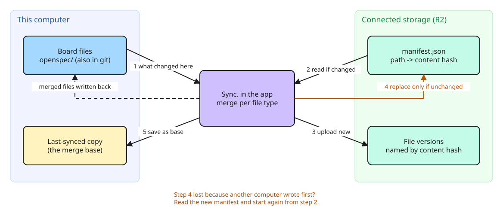
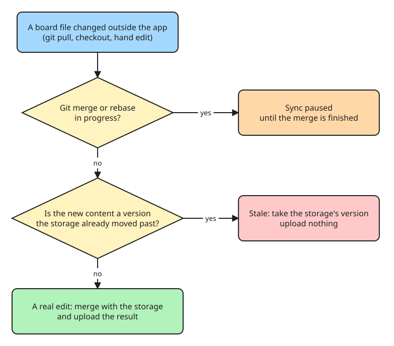

# Board sync through blob storage, 12 Nov 2026

- **Status:** built and security-tested 2026-11-12, #wi160 In Review: all chunks and all security fixes merged in the main tree (uncommitted), 872 fast tests green, real-app runs on the hidden desktop with a Folder storage; still open: a first run against a real R2 bucket (needs the owner's bucket and token), number blocks deferred, the conflict wording (see "State on 12 Nov" under Chunks)
- **Date:** 2026-11-12
- **Author:** Claude (agent)
- **Work items:** none yet (to be filed when the app is open)

## Why

"i dont want to commit and pull stuff each time i want to see my updated tasks on another computer. we should think about external storage" and then: "i lean towards b [a synced folder]. but with something that gives us more control (api), like blob storage so we can implement our own merge rule controls".

One user, two or three computers, sometimes offline, plus agents writing through the board server on one machine. The files stay plain text on disk.

Then, 12 Nov: "ok, lets set this up. i want settings to make it possible to choose per/project connected storage (file explorer or connected storage). in the future i am planning to expand supported storage endpoints, like sharepoint, blob, google drive, etc. we need to think how merge conflicts would work. like, openSpec still exists in git and will be updated by agents. I just want external storage for real time sync. on change, app checks with the online server, resolves conflicts if any. after git pull me opening the app - it checks online server for other changes it missed and resolves conflicts."

## What the industry does

### File-sync apps over a dumb store

| Tool | State kept per device | Conflict rule | Deletes | What users complain about |
|---|---|---|---|---|
| Joplin (S3, WebDAV) | sync time per item | remote wins, local copy to a Conflicts notebook; no merge | listing diff plus a deleted-items table | conflict floods, stale lock files, slow with many small files |
| Obsidian Sync | proprietary | markdown merged with diff-match-patch, JSON by key, the rest last-modified | not documented | stale devices bringing deleted files back |
| Remotely Save (S3, WebDAV) | previous-sync record | newer or larger wins; paid merge for small markdown | inferred from the record | modified-times that change on open |
| Obsidian LiveSync | revision last written to each file | merge only against a shared ancestor, else ask | deleted marker | needs CouchDB |
| rclone bisync | listings of the previous run | configurable (newer, larger, keep both) | from the prior listing, 50% brake | one failed run forces a full resync |
| Logseq file sync | file timestamps | newest wins | | overwrote remote content; the team moved to a database |
| KeePassXC | none (one file) | per entry: newer wins, older goes to history | delete wins only if the entry was not edited after it | |

What recurs:

- **A last-synced base on every device** (Dropbox's three trees, rclone's prior listings, Remotely Save's record). Without it "deleted here" and "created there" look the same.
- **Newest-timestamp-wins is what loses data** (Logseq, early Remotely Save). The better tools decide by content hash, revision or ETag, never by file modified-time.
- **The loser is kept**: history, a conflicts notebook, an attic file.
- **A brake on mass deletion**: rclone and Remotely Save abort at 50% of files, Joplin at 90%, because an empty listing usually means misconfiguration.
- **Locks on a dumb store go stale** (Joplin). A conditional write on one object replaces them.

### Task trackers and merge rules

- **TaskChampion (Taskwarrior 3)** is the closest prior art: it syncs through a GCS or S3 bucket with no server. Versions are immutable objects; one object named `latest` is updated only by compare-and-swap, and a version counts as committed when that update succeeds. Losers rebase and retry. Lists are stored as one key per member (`tag_x`, `dep_<uuid>`), so no shared list is overwritten.
- **tbd** (markdown and YAML per issue, the nearest data shape): scalars last-writer-wins, description last-writer-wins with the loser saved to an attic file, labels union, dependencies by key, ULID ids with a short alias.
- **Beads**: sequential ids collided when two branches both created `bd-10`; it moved to hash ids. It also gave up on JSONL as the source of truth.
- **git-bug**: operations ordered by Lamport clocks; wall clocks rejected.
- **Trello**: conflict resolution "ranked very low" in practice; last-writer-wins was enough, except "for long-form fields like descriptions".
- **Linear, Figma**: property-level last-writer-wins, ordered by a server. Figma puts a client id inside object ids so creation works offline.
- **CRDTs (Automerge, Yjs)**: correct, but the files become binary, history grows, and Cinapse moved away because its data was fields, not text. Overkill for one person and agents.
- **Clocks**: wall-clock last-writer-wins breaks under skew; a hybrid logical clock (time, counter, device id) stays monotonic and is what offline-first apps settle on.

### What the stores give us

| Store | Write only if unchanged | Strongly consistent | Versioning | Cost at our size | Note |
|---|---|---|---|---|---|
| Cloudflare R2 | yes | yes | no | free | no conditional delete; tokens scoped per bucket |
| Amazon S3 | yes (since Nov 2024) | yes | yes | about $0.25 a month | conditional delete since Sep 2025 |
| Azure Blob | yes, plus leases and append blobs | yes | yes | about $0.25 a month | its own API |
| Google Cloud Storage | yes (generation numbers) | yes | yes | about $0.25 a month | its own API |
| MinIO (self-hosted) | yes | not checked | yes | own hardware | S3 API |
| Backblaze B2 | apparently not | not checked | not checked | free | Proxmox had to disable conditional writes for it |

- Change detection: event feeds all need a queue or endpoint of our own. One small manifest object polled with a conditional read (a "not modified" answer is one cheap request) every 30 to 60 seconds is the pattern that fits a desktop app: about 14,000 requests a month.
- Auth with no backend: a long-lived key scoped to one bucket, on each machine, kept with Windows' per-user protection (DPAPI).
- The five calls needed (put, get, head, delete, list) fit plain `HttpClient` with request signing; whether the official SDKs trim into the single exe is unmeasured.

## Proposed design

State-based sync: whole files, a three-way merge per file type, one manifest updated by compare-and-swap. This is TaskChampion's `latest` trick with file states in place of operations, and tbd's merge rules.

- **Remote layout:** each file version is an immutable object named by its content hash, written with "create only if absent". One `manifest.json` maps path to hash and carries tombstones; it is replaced only if its ETag is the one we read.
- **Local state:** the last-synced manifest and the base copies of the files, outside the repository (app data). This is the merge base; store versioning is not relied on (R2 has none).
- **Loop:** hash the local files; conditional read of the manifest; for each path changed on both sides run the merge rule; upload new objects; swap the manifest; on a lost swap, start again from the new manifest. The base is updated only after a successful swap.
- **Where the board lives:** unchanged, `openspec/` in the repository, so OpenSpec, the agents and git keep working. Sync writes into it like any outside edit, and the watcher already reloads the app.

### Storage is chosen per project

Settings, per project, "Board storage":

- **This folder only** (today's behaviour, the default): the board is the files in the repository, nothing is synced.
- **Connected storage**: a provider, its address (for R2: account endpoint, bucket, prefix) and a key, with "Test connection" and the sync state (last sync, pending, error).

What is stored where:

- The provider and its address go in the project's settings in the repository (`openspec/REPO-TASKS.md`), so the second computer learns them from git and only asks for the key.
- The key never goes in the repository: it is kept per computer, per project, under Windows' per-user protection (DPAPI).
- Each computer has a device id (made once, in app data) used in clocks and in conflict notes.

### Providers

One small contract, so SharePoint, Azure Blob, Google Drive and others can be added without touching the sync loop:

| Call | Meaning |
|---|---|
| `Get(path)` | bytes and an opaque version token, or "not there" |
| `GetIfChanged(path, version)` | "not modified" or the new bytes and token |
| `Put(path, bytes, onlyIfVersion or onlyIfAbsent)` | the new token, or "someone else wrote first" |
| `Delete(path)` | |
| `List(prefix)` | paths and tokens |

- The version token is opaque: an ETag on R2, S3 and Azure, a generation number on Google Cloud Storage, an eTag on SharePoint and OneDrive, a revision on Dropbox. The loop never looks inside it.
- First version ships two providers: **S3-compatible** (R2, also S3 and MinIO) and **Folder** (a path; the conditional write is a lock file plus atomic rename). The folder provider is the test double for every sync test and also a real option (a network share).
- A provider that cannot do a conditional write (Backblaze B2, possibly Google Drive) needs the fallback where each device writes only its own manifest and merging happens on read. Not built now; the contract leaves room by reporting "conditional writes: no".

### When sync runs

**Replaced on 12 Nov (decision #n319), at the owner's direction: the cheapest working solution, not live collaboration.** The app syncs when a project opens, when the app closes (15-second limit), two quiet minutes after the last change (each change restarts the wait), and on "Sync now". No periodic timer, no back-off, no idle tracking: an early or late sync is put right by the next one. A computer left open and idle receives nothing until its next change, restart or Sync now. The service's tests await the trigger they call and wait for nothing. The list below is the first design, kept for the record.

- **On a local change**: debounced about 2 seconds after the last write to the board (the app's own saves, the board server's writes for agents, outside edits seen by the watcher).
- **On a timer**: one conditional read of the manifest every 30 to 60 seconds while the app is open.
- **On start, and when git moved**: a full reconcile (hash every board file against the base). "Git moved" means HEAD or the checked-out branch is not the one recorded at the last sync.
- Sync runs in the desktop app only (the board server dies with it, so agents are covered). One sync at a time per project.

### Git and sync together

The board stays in git; agents and the user keep committing it. To sync, a `git pull` is just another outside edit: files that differ from the base are local changes, merged three-way against the storage. Four things make that safe:

1. **Old content that comes back is not an edit.** A checkout of an older branch or a pull of an older commit rewrites files to content the storage has already seen and moved past. The manifest keeps, per path, the hashes of its recent versions. A file that changed outside the app and whose new hash is one of those past versions is stale: the storage's version wins and nothing is uploaded. A change made in the app (or by an agent through the board server) is always an edit, even when it restores old text.
2. **Sync stops while git is mid-operation.** While a merge, rebase or cherry-pick is in progress, or any board file contains conflict markers, nothing is uploaded and nothing is written; the app says "sync paused: finish the git merge". It resumes with a full reconcile.
3. **Two computers committing the same synced state do not conflict in git**: the content is identical. For the case where one is slightly ahead, the app adds `openspec/**/events.log merge=union` to `.gitattributes` (as it already does for the `.gitignore` exception), so the worklogs merge themselves.
4. **Branches do not fork the board.** There is one synced board per project, whatever branch is checked out. Agent worktrees are not synced; agents reach the board through the tools with `repo` = the main repository.

What the user sees after "git pull, then open the app": the reconcile runs, storage-side changes he missed are written into the files, his pulled changes that are genuinely new go up, and anything that needed a rule (both sides changed a field, an overlap in a description) appears as an event or a conflict note on the item.

### First connection

- **Empty storage**: the local board is uploaded and becomes the base.
- **Storage already has a board** (the second computer): files that are identical are marked synced; files only here are uploaded; files only there are downloaded; files that differ take the storage's version, and this computer's version is kept in a backup folder in app data, listed in one notice. No base exists yet, so no finer merge is possible.

### Merge rules

| Data | Rule |
|---|---|
| Scalars in the item YAML (title, status, priority, label, dates) | Against the base: the side that changed wins; both changed: later hybrid clock wins and the loser is written to the worklog as an event |
| Lists (contributors, tests, commits, docs, dependencies) | Each side's adds and removes against the base (a plain union would resurrect removals) |
| Subtasks | Keyed by a stable hidden id per line; text, tick and order merged per subtask; numbers rewritten on save |
| Description, note bodies | Text three-way merge; on a true overlap keep the newer text and save the other as a conflict note on the item |
| Notes | The note id is the identity; two new notes are both kept |
| `events.log` | Union of lines, deduplicated, ordered by clock; never conflicts |
| Delete, archive | A tombstone with a clock; an edit made after the delete brings the item back and flags it |
| Safety | Abort and ask when a sync would delete more than a set share of the files |

### Ids

Two offline machines will both allocate the same next `#wiN` or `#nN`; max-plus-one cannot survive that (Beads' `bd-10` collision). Proposed: every item and note also gets an immutable internal id; the display numbers stay, and each device takes a reserved block of numbers from a counter object by compare-and-swap while online (say 50 at a time). A collision that still happens is repaired by renumbering the newer one and rewriting the `#wiN` / `#nN` references.

## Decisions

Decided by the owner:

1. **Store:** Cloudflare R2 first, through an S3-compatible provider; more providers later (SharePoint, Azure Blob, Google Drive), so the provider contract above is part of the first version.
2. **The board stays in git**; the storage is only for real-time sync between computers.
3. **Storage is a per-project setting**: this folder only, or connected storage.

Taken from the recommendations, open to change:

4. **Ids:** `#wiN` and `#nN` stay; each device reserves a block of numbers while online. The alternative is hash-style ids like Beads, which changes every id on screen.
5. **Encryption:** none client-side in the first version; the bucket is private and the key is scoped to it.

Decided while building, 12 Nov (each is also a decision note on #wi160):

6. **Reserved number blocks are deferred** (#n278). Two computers may still allocate the same id offline; the duplicate-id repair of #wi159 renumbers the later one after the sync. This replaces decision 4 for the first version.
7. **Deletions still sync, but sync never erases a file** (#n285). The owner proposed prohibiting deletions; archiving, merging and renumbering are deletions underneath, so a ban would show archived items twice. Instead a file the sync removes on a computer is moved to `trash/<time>/<path>` in the sync state folder, kept 30 days, and an edit that loses to a delete also becomes a conflict note. Ruled out: a ban, and "an edit always beats a delete" (it resurrects lone files of an archived item).
8. **Old content is recognised without a history cap** (#n289). The manifest's 20-version list would let a week-old branch roll a busy file back for everyone. Instead:
   - this computer keeps every hash it has ever seen for a path, uncapped, in its state folder;
   - the upload is the question: a "create only if absent" put that the storage refuses means this file has had this content before, so it is stale. No extra request. What a sync is about to upload is recorded first (`pending.json`), so an interrupted sync's own upload is not mistaken for old content;
   - objects are named by path plus content (`sha256(path + "\0" + content hash)`), so the same text in two files is two objects and one file's old text is never mistaken for another's. A moved file is uploaded again;
   - `events.log` changed outside the app is always union-merged with the storage's log, never replaced, so an old log cannot remove lines.
   - A provider without conditional writes uses the local memory only.
9. **Known limits kept for now:** a deletion is stamped when the sync notices it, not when it happened (harmless with the trash and the conflict note); tombstones and old objects in the storage are never cleaned up (any future clean-up must keep what decision 8 relies on); one manifest for the whole board (split per work item if several people sync); the app and a board server repairing duplicate ids in the same instant are not guarded.

## Chunks

State on 12 Nov, end of day: `merge`, `provider`, `loop`, `git`, `host` (the `ui` row below plus triggers and conflict notes), `trash` (decisions 7 and 8) and `close` (explicit blocked reason, git pause and trash in the state line, which side lost a conflict, app edits kept across a restart) are all integrated in the main tree, uncommitted; `ids` deferred (decision 6). Full suite 749 green; spec delta on #wi160; the merged feature was run in the real app on the hidden desktop (two demo git repositories, Folder storage).

Differences from this plan as built: the provider and address are saved in `openspec/config.yaml` under `x-rtm.boardStorage`, not in `REPO-TASKS.md` (the app rewrites that file); the sync state, key, device id and trash live under the app data folder, `sync/<project>/`.

Security test, 12 Nov (decision #n300): two agents proved 47 defects with failing tests (`SecurityOfBoardSyncTests`, `SecurityOfConnectedStorageTests`); all are fixed and merged, 872 fast tests green. What changed in behaviour:

- **A storage named in the repository is a proposal.** Nothing is built, touched or sent until this computer approves that exact provider and address ("Allow this storage"); `approval.json` in the project's sync folder. Keys are bound to the address they were entered for; a pull that changes the address unbinds them. Going back to "This folder only" deletes keys and approval.
- **Folder paths:** absolute only; not inside the board, the repository's `.git`, or containing the board; a network share only through approval.
- **Transport:** https only (http for the local machine), no redirects, awkward endpoints and prefixes refused, key id masked to its last 4 characters and DPAPI-protected like the secret.
- **Links are never followed** on scan, write, delete or trash; skipped links are reported.
- **Every file a sync replaces is copied to the trash first**; the deletion brake counts over 24 hours; no brake on overwrites.
- **Clocks** from the storage are validated and capped a day ahead; **manifests** with nulls, bad paths (device names, trailing dots, case-only duplicates), oversized content or long histories fail the sync cleanly.
- **Conflict markers** only pause sync for files changed outside the sync, and not inside code fences.
- **Notes and plans:** only http, https, mailto and relative links are live; only repository images render; a content security policy is set (inline styles are the one thing left open).

Open:
- a first run against a real R2 bucket (the S3 provider is verified against a fake and the AWS signature example only);
- the conflict event says "this computer's" / "another computer's" change from the writer's side and reads backwards on the other computer: name the computer instead;
- the `ids` chunk (number blocks), if collisions turn out to be frequent.

Order: `merge` and `provider` have no dependencies and start together; `loop` needs both; `git`, `ids` and `ui` need `loop`.

| Chunk | What | Test |
|---|---|---|
| merge | Pure merge functions per file type, with the base | unit tests per rule, including both-changed and delete-versus-edit |
| provider | The contract, the Folder provider, the S3-compatible provider (signed `HttpClient`) | one test set run against both; S3 against a local MinIO or a fake with the same answers |
| loop | Local base, manifest swap and retry, triggers, deletion brake, first connection | two folders and one Folder store: offline edits on both sides, then sync both ways |
| git | Stale-content rule, pause during a merge, `.gitattributes` line, reconcile when HEAD moved | a demo repository: checkout an old commit, pull, conflict markers |
| ids | Internal ids, reserved number blocks, collision repair | two devices creating items offline |
| ui | Per-project "Board storage" settings, key storage, test connection, sync state, conflict notes | hidden desktop, light and dark |

## Verification

- Two demo repositories against one fake store: every row of the merge table exercised end to end.
- Fast suite and CLI suite green.
- Real R2 bucket check by the owner, since it needs his account.

## Sources

- TaskChampion sync model and cloud backend: https://gothenburgbitfactory.org/taskchampion/sync-model.html , https://raw.githubusercontent.com/GothenburgBitFactory/taskchampion/main/src/server/cloud/server.rs , https://raw.githubusercontent.com/GothenburgBitFactory/taskchampion/main/src/server/op.rs
- tbd design: https://cdn.jsdelivr.net/npm/tbd-git@0.1.7/dist/docs/tbd-design.md
- Beads: https://github.com/steveyegge/beads
- git-bug model: https://www.github.com/MichaelMure/git-bug/blob/master/doc/model.md
- Trello offline sync: https://www.atlassian.com/blog/atlassian-engineering/sync-failure-handling
- Linear sync engine (reverse-engineered): https://github.com/wzhudev/reverse-linear-sync-engine
- Figma multiplayer: https://www.figma.com/blog/how-figmas-multiplayer-technology-works/
- Local-first software: https://www.inkandswitch.com/essay/local-first/
- Why Cinapse left CRDTs: https://www.powersync.com/blog/why-cinapse-moved-away-from-crdts-for-sync
- Hybrid logical clocks: https://jaredforsyth.com/posts/hybrid-logical-clocks/
- Joplin sync and locks: https://joplinapp.org/help/dev/spec/sync/ , https://joplinapp.org/help/dev/spec/sync_lock/
- Obsidian Sync conflicts: https://obsidian.md/help/sync/troubleshoot
- Remotely Save algorithm: https://raw.githubusercontent.com/remotely-save/remotely-save/master/docs/sync_algorithm/v3/design.md
- LiveSync conflict rules: https://raw.githubusercontent.com/vrtmrz/obsidian-livesync/main/docs/specs_conflict_resolution.md
- Logseq, why the database version: https://discuss.logseq.com/t/why-the-database-version-and-how-its-going/26744
- rclone bisync: https://rclone.org/bisync/
- Dropbox sync engine: https://dropbox.tech/infrastructure/-testing-our-new-sync-engine
- KeePass synchronisation: https://keepass.info/help/v2/sync.html
- Syncthing conflicts: https://docs.syncthing.net/users/syncing.html
- S3 conditional writes: https://docs.aws.amazon.com/AmazonS3/latest/userguide/conditional-writes.html
- R2 S3 API, consistency, pricing: https://developers.cloudflare.com/r2/api/s3/api/ , https://developers.cloudflare.com/r2/reference/consistency/ , https://developers.cloudflare.com/r2/pricing/
- Azure Blob concurrency: https://learn.microsoft.com/en-us/azure/storage/blobs/concurrency-manage
- GCS preconditions: https://docs.cloud.google.com/storage/docs/request-preconditions
- Backblaze B2 and conditional writes: https://lore.proxmox.com/all/20250728100154.556438-3-c.ebner@proxmox.com
- Delta Lake put-if-absent commits: https://delta.io/blog/2022-05-18-multi-cluster-writes-to-delta-lake-storage-in-s3/
- Standalone SigV4 signer for .NET: https://aws.amazon.com/blogs/developer/introducing-a-standalone-sigv4-signer-for-the-aws-sdk-for-net/

Not verified by the research: conditional writes on B2's native API, prefix-scoped keys on R2, trimming of the official .NET SDKs, Things Cloud and Asana internals (nothing public).
