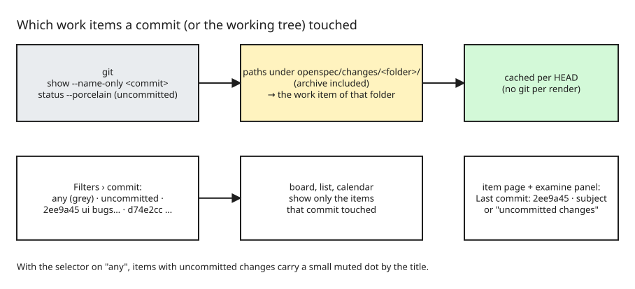

# Git deltas: filter the board by commit or by uncommitted work (#wi176)

Status: built and verified in the real app (light and dark), in review; one chunk, done in the worktree `git-deltas`

## Why

The owner wants a selector in the menu to pick one commit (or "uncommitted") and see only the work items that were in it, and the last contributing commit in the item's metadata. Two subtasks: highlight uncommitted changes, highlight the changes of a specific commit.

## How others do it

- GitLens (VS Code) keeps "working changes" as their own entry next to the commits in its views, and compares the committed version with the working directory: uncommitted is a peer of a commit, not a flag on one. Source: https://help.gitkraken.com/gitlens/gitlens-plus
- JetBrains IDEs split it in two places: the Commit tool window lists uncommitted files (modified in blue, new in green), and the Log tab's Changed Files pane lists exactly the files of the selected commit. Source: https://www.jetbrains.com/help/idea/log-tab.html

What we take from both: one selector whose first entries are "uncommitted" and the commits, picking one narrows the view to what that entry touched (JetBrains' Changed Files pane), and a quiet marker for modified files while nothing is picked (JetBrains' blue highlight).

## Decisions

1. A commit touches a work item when one of its files is in the item's change folder (`openspec/changes/<folder>/...` or `openspec/changes/archive/<date-folder>/...`; the archive date prefix is dropped, as AuthorsOfChange does). Read from the one cached `git log --name-only` over `openspec/changes` that GitHistory already runs for contributors, extended with hash, subject and date; no extra process per commit. Cached per HEAD.
2. Uncommitted = `git status --porcelain -uall -- openspec/changes` paths, mapped to folders the same way. Dirty state does not move HEAD, so it is cached under HEAD plus a fingerprint of the files in `openspec/changes` (path, size, write time): one directory walk, no process, until something is saved.
3. The selector is a `commit` dropdown in the Filters section (any, uncommitted, the last 30 commits as `abc1234 subject`), saved per board in `BoardOptions.Commit` ("any" by default, grey while neutral). It filters board, list and calendar in `BoardModel.Visible`. The folded Filters header says `commit: abc1234`.
4. The marker for uncommitted changes (selector on any): one small muted dot before the card title, tooltip "Uncommitted changes". No frame, no badge. Shown on cards (list rows are unchanged).
5. Metadata: the item page header gets a `last commit` field (`abc1234`, subject as tooltip, or `uncommitted`), and the examine panel one line `Last commit: abc1234 · subject`.

## Chunks

| Chunk | What | Tests |
| --- | --- | --- |
| git-deltas | GitHistory queries (files of a commit, dirty folders, last commit per change), `BoardOptions.Commit` + filter, Filters selector, card dot, item header and examine line | ReadingGitHistoryTests, ArrangingTheBoardTests, UsingTheBoardTests |

## Verification

Tests first (temp git repos with fixed author and committer dates). Then the hidden-desktop app on a demo repo with two commits and one uncommitted edit: shots in light and dark of the open selector, the filtered board, the marker, the item header line (`git-deltas-*`).
