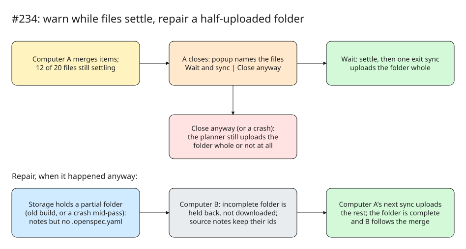

# A half-uploaded change folder: warn first, repair after (#wi234)

Status: done 2026-11-27 — chunks A and B plus two fixes (close guard reads live file times; stale/own-download entries excluded) staged; regression 1523 passed, 0 failed; the close dialog, Close anyway → hold-back → completion, and Wait and sync verified in the real app (#234 In Review)

Builds on `board-sync-openspec-rules-2026-11-26.md` (the folder pass, the put-back rule) and the settle window from #wi170 (files changed in the last 10 s are deferred, 5-minute cap).

## Why

During the #wi233 verification computer A was closed while 12 of a merged folder's 20 files were still inside the settle window. The exit sync uploaded the 8 settled notes and nothing else; the state line had said "Nothing new". Computer B downloaded a folder with notes but no `.openspec.yaml`; its duplicate-note-id rule renumbered the still-present source item's notes, and the sync failed on a changed `events.log`.

Owner, 2026-11-27: "app should show a popup warning. if it indeed happens, the next app instance reaching storage should be the ones fixing it".

## What the industry does

- Sync tools that move folders atomically stage every file of a unit and publish a single manifest entry last (rsync `--delay-updates`, 2024 docs; Syncthing's "folder in sync" state, 2025). The manifest here already is the single publish point: holding a whole change folder back until it settles is the same idea.
- Editors warn on close with unsaved or in-flight work (VS Code "unsaved changes" / "operations in progress" dialogs). The exit sync is in-flight work.

## Design

1. **Folder as a unit.** The planner knows which local paths are still settling (`SyncOptions.Settling`, from the host's existing deferral list). A change folder with any settling file is held back whole: none of its files are uploaded this pass; the report counts them as waiting.
2. **Say so.** The state line reads "Waiting for N files to settle (folder …)" instead of "Nothing new". Sync now with settling files shows the same line.
3. **Warn on close.** When the app closes while files are settling, a dialog names the files and the folder and offers "Wait and sync" (waits for the settle window, then the exit sync) or "Close anyway". Tests drive the dialog's model, not the OS.
4. **Repair.** The receiving side treats a change folder in the storage without `.openspec.yaml`, or whose `mergedFrom` names items still live in the storage, as incomplete: it is not downloaded and not counted, and the duplicate-id rule does not renumber the sources' notes while such a folder exists. The computer that made the move uploads the rest on its next sync (the files are local-newer-than-base), after which the folder is complete and flows normally.

## Chunks

| # | Chunk | Owns | Tests (display names) |
|---|---|---|---|
| A | Warn: state line and close dialog | `TaskManager/BackgroundJobs/BoardSyncService.cs` (status text, exit path), `BoardStorageSection.razor`, the close dialog component, `MainLayout`/shutdown hook | "The state line names the files still settling" · "Closing with files still settling warns and names them" · "Wait and sync closes after the files settle" · "Sync now with files still settling says so" |
| B | Unit upload and repair | `BoardSync/Sync/SyncPlanner.cs`, `FolderWork.cs`, `SyncModels.cs`, `SyncOptions` (+ its one wiring line in BoardSyncService), `Notes/Queries.cs` (Settle guard) | "A folder with files still settling is not uploaded in part" · "An incomplete folder in the storage is held back" · "Sources of an incomplete merged folder keep their note ids" · "The computer that made the merge completes a half-uploaded folder on its next sync" |

## Verification

Hidden app, two boards on one Folder storage: merge on A, close A within 10 s → the dialog; "Close anyway" → B syncs, sees nothing of the merged folder, keeps its source notes; A opens and syncs → B gets the whole merged item.
