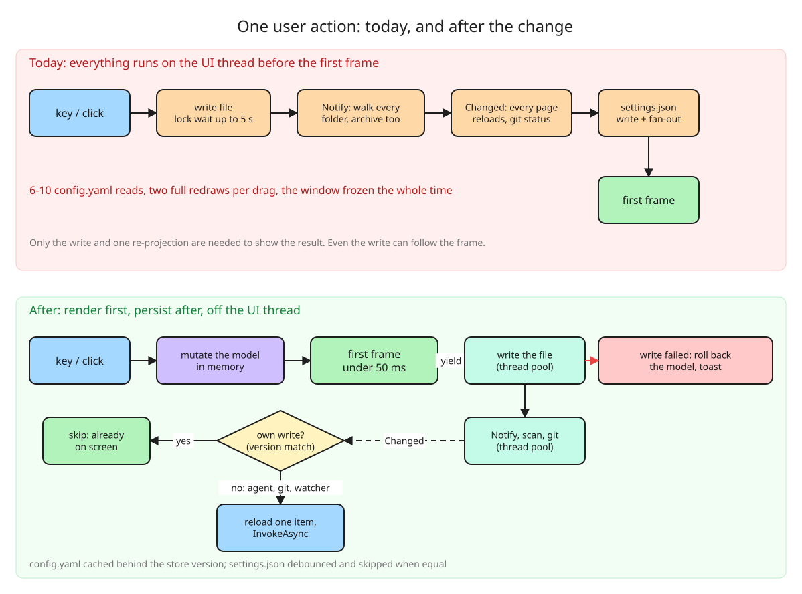

# Instant UI: render first, persist after

Status: planned, 17 Nov 2026. Nothing built. Research and the code analysis behind this plan: `local/research/ui-responsiveness-2026-11-17.md` (sources dated, [S]/[I] marked).

## Why

The owner: "ui should react to my actions INSTANTLY. ALL OF IT." The arrow-key fix (#wi194) measured 180 to 275 ms from key to redraw. A drag, a status change, a subtask tick and a note save are slower, and the window freezes while they run.

Phase 1 of `list-render-cost-2026-11-16.md` (#wi80, #wi89, #wi90, #wi91) made a *click* cheap by cutting renders: a click that writes nothing is now under 100 ms. This plan is about actions that **write**: every one of them does its disk work, lock waits, directory walks and a `git status` process on the UI thread before the first frame.

## Facts (from the code analysis, file:line in the research note)

Every handler runs on Photino's one UI thread, which is also the window's message loop. Nothing paints until the synchronous part of the handler ends. No handler awaits before it writes. So between the event and the first frame:

1. The command writes its files synchronously: a cross-process folder lock polled with `Thread.Sleep` for up to 5 s (`OpenSpecStore/FolderLock.cs:20-43`), a temp write and a move that retries up to about 1 s, twice per command (the yaml, then `events.log`).
2. `Workspace.Notify` (`Workspace.cs:272-310`) reads `config.yaml` per project (uncached), walks every change folder including `archive/`, and lists every notes folder, before `Changed` fires.
3. `Changed` reaches every page synchronously; each `Load`s inline (`RepoPage.cs:62-93`, `InvokeAsync` runs inline on the dispatcher). The board view and the item page spawn `git status` synchronously (`GitCache.cs:108-124`) because the version moved.
4. A drag runs two or three full Loads (`Run`, then `Set(PlaceCards)`, plus a swimlane write), each with a full card or grid redraw from the unconditional `loadVersion++` / `listVersion++` (`BoardPage.razor.cs:226,240`).
5. Arrow keys and drops write `settings.json` on every press, even unchanged (`Set`, `BoardPage.razor.cs:291`), and the settings fan-out does two JS interop calls and rebuilds the side menu.
6. Six to ten `config.yaml` reads and YAML parses per action: `GetStatuses`, `GetLanes`, `GetWarnings` in the board markup (`BoardPage.razor:20`), `PlansState` per Notify, `SetStatus`.

Only the command's own write and re-projecting the one changed item are needed before the result can show. Even the write can follow the frame.

## What others do

- Linear, Electric and Zero mutate the in-memory model at once, persist in the background, tag each write and recognise its own echo instead of re-applying it; a rejected write rolls back alone. (research note, section "Optimistic UI")
- Microsoft's .NET 10 Blazor guidance: set state, `StateHasChanged`, `await Task.Yield()`, then slow work; never block the sync context; external events through `InvokeAsync`.
- JetBrains: no file-system work on the UI thread; listeners only invalidate caches; dev builds assert on slow UI-thread operations.
- web.dev: a task over 50 ms is long; visible update first, then yield, then save. Under 100 ms feels like direct manipulation.

## Decisions

1. **Render first, persist after.** A page applies the command's result to its in-memory projection and renders before any disk write. The write runs on the thread pool. A failed write puts the previous projection back and shows a toast. Decided because every source does it and nothing in the result depends on the write succeeding first.
2. **A page skips its own echo.** The page records the store version its write produced; a `Changed` carrying only that version does not reload. Changes from agents, git or the watcher still reload, one item where possible. Decided over "reload everything and diff" because the double redraw is the second-largest cost.
3. **Nothing blocks the UI thread.** Lock waits, `MoveOver` retries, the duplicate scan, `git status` and `FeaturesCache` rebuilds run on the thread pool, their results marshalled with `InvokeAsync`. `Notify` gets a lock around `resolving` and `scanned`, which today are plain fields touched from the watcher's timer thread, Kestrel threads and the dispatcher.
4. **No new abstraction.** No command queue type, no optimistic-store layer: the existing `RepoPage.Run`, `Workspace.Do`, `BoardPage.Set` and `SettingsStore.Update` change shape. If a per-file write queue is needed for the stale checks, it is a `SemaphoreSlim` per path in `OpenSpecStore`.
5. **The test routine changes with it.** Render-budget tests stay the guard for renders; new tests count disk reads, lock waits and git processes per action (`GitHistoryModule.Processes` exists, nothing asserts on it). The hidden app gets a used-board preset and list helpers, and every integration ends with an exploratory pass.

## Chunks

Each chunk: failing test first, then the change, then a CDP check on the hidden app in light and dark over the used-board preset. Chunk agents run only the classes named; the full suite runs once after integration.

### Chunk 1: render first in the board (BoardPage.Set, Land, Load)
- `Set` compares the new `BoardOptions` with the old and returns when equal; otherwise it re-sorts the cached items in memory, renders, then saves settings on the thread pool (debounced, 250 ms).
- `Land` projects the moved cards into the target column before `MoveInto` writes; one Load, one version bump; the persisted result is checked against the projection and only a mismatch reloads.
- `Load` bumps `loadVersion`/`listVersion` only when the projection changed (compare the row id sequence and the per-item `Presented` instances).
- Tests: extend `BoardRenderBudgetTests` and `ListRenderBudgetTests` with "ArrowUp renders once and writes nothing to disk", "a drop renders once and runs no git process"; `KeepingMyArrangementsTests` for the debounced settings save (injected `TimeProvider`).
- Files: `BoardPage.razor.cs`, `BoardModel.cs`, `SettingsStore.cs`.

### Chunk 2: the write path off the UI thread (RepoPage.Run, Workspace.Do, Notify)
- `RepoPage.Run` becomes: apply the result's projection (the command already returns the written item), `StateHasChanged`, `await Task.Yield()`, then `Workspace.Do` on the thread pool.
- `Workspace.Notify`: `Changed` fires first with the written version; the duplicate scan and `PlansState` run afterwards on the thread pool under a lock; a renumbering raises a second `Changed`.
- `RepoPage.OnChanged` skips a `Changed` whose version equals the page's own last write.
- The `AsyncLocal` repo scope (`Workspace.In` / `InRepo`) is captured inside the background work. Per-path `SemaphoreSlim` in `OpenSpecStore` serialises queued writes so the `LastSeen` stale check stays sound.
- Tests: new `WritingWithoutBlockingTests`: a command whose write holds the folder lock for 2 s (injected) still renders within one dispatcher turn; `Notify` called from three threads at once runs the scan once; the page's own echo causes no second Load (`Loads` counter). `CachingInAppStateTests` for the scan running after `Changed`.
- Files: `RepoPage.cs`, `Workspace.cs`, `OpenSpecStore/Commands.cs`, `OpenSpecStore/FolderLock.cs`.

### Chunk 3: git status and config reads
- `GitCache.Uncommitted` returns the last known set at once and refreshes on the thread pool; the dirty dot updates through `Changed` when the process ends.
- `config.yaml` (`GetStatuses`, `GetLanes`, `GetWarnings`, `PlansState`, `AttachmentsDir`) cached behind the store version in `OpenSpecStore`; `GetWarnings` leaves the board markup for `Load`.
- `FeaturesCache` keyed on the `specs/` folder stamp, not the repo-wide version.
- Tests: `CachingInAppStateTests`: "a status change reads config.yaml zero times and spawns no git process before the first render"; `GitHistoryModule.Processes` asserted per action.
- Files: `GitHistory/GitCache.cs`, `OpenSpecStore/Queries.cs`, `WorkItems/Queries.cs`, `Features/FeaturesCache.cs`, `SettingsStore.cs`.

### Chunk 4: the verification routine
- `New-DemoRepo -Used`: the real-data copy plus a settings preset with list grouping by status, default priority sort, a saved grid header sort, an `Order` holding keys from another column, and a group of five or more rows mixing high and low with `Modified` ties.
- `hidden-app.ps1` helpers: `ListRows [group]` (ids of `tr[data-id]` in DOM order), `Select $id`, `Press $key` (returns `ListRows`), `Assert-Swap $before $after $id $dir`, `Set-ListGrouping`, `Set-GridSort`.
- `tests/exploratory.ps1`: the checklist as a script: each grouping with and without a header sort, Up and Down on the first, middle and last row, a drag, a status pill, a subtask tick, in light and dark, one screenshot per step. Run after every integration; its output is the evidence.
- Tests: `MovingRowsWithArrowKeysTests` gains the parametrised case over {grouping} × {sort incl. header sort} × {middle row}.
- Files: `tests/hidden-app.ps1`, new `tests/exploratory.ps1`, `TaskManager.Tests/MovingRowsWithArrowKeysTests.cs`.

Dependencies: chunks 1, 3 and 4 are independent. Chunk 2 touches `RepoPage.Run`, which chunk 1's `Land` calls through `MoveInto`; chunk 2 integrates after chunk 1, and its agent starts from the integrated tree. Chunk 4 runs first if possible, so chunks 1 to 3 verify with its helpers.

## How it is verified

- Each chunk: its named test classes green; a CDP run on the used-board preset, light and dark, screenshots under `tests/out/shots/wi<id>-*`.
- After integration: the full fast suite once (merge agent), then `tests/exploratory.ps1` end to end. The target from the sources: first frame under 100 ms for every action in the checklist, no `git` process and no disk read before it.

## Risks

- Stale-check refusals: two optimistic edits racing a background write. Covered by the per-path semaphore and a test in chunk 2.
- A failed background write after an optimistic render: rollback plus toast, tested in chunks 1 and 2.
- Radzen rebuilding rows when `rows` is a new list: chunk 1 reuses `GridRow` instances; `ListRenderBudgetTests` guards it.
- Decision n494 left grid-isolation and param-hygiene unbuilt; this plan does not reopen them.
