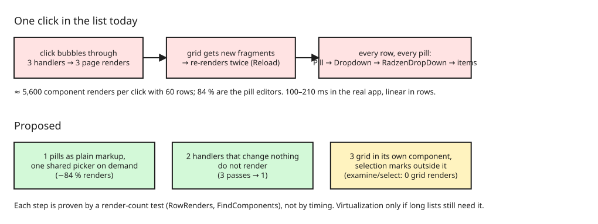

# List view: what one click costs, and how to make it cheap

Status: phase 1 built (render-counter, one-render-click, light-pills; 16 Nov 2026). Every list click now takes under 100 ms in the real app: examine 13–86 ms, Shift-click 19–34 ms, opening a pill 35–49 ms. grid-isolation and param-hygiene are not built, by decision n494. The numbers below are the "before" baseline.



## Why

The owner: "A click in the list re-renders the whole grid, about 115 renders per click. Why? Research how to do it properly!"

## Facts

### What the "115" is

The 115 (92 → 207 → 321) is bUnit's `RenderCount` of `BoardPage`. bUnit counts every render batch in which the component **or any descendant** rendered, so it is a count of batches, not of BoardPage renders. With the fixture plus 50 items (54 rows, 7 group rows) the probe saw +134 per plain click and +68 per Shift-click. Radzen components finish their parameter handling asynchronously (the grid's `Reload` and each dropdown), so one click spreads over many small batches. BoardPage itself rendered **twice** per click (its `OnAfterRenderAsync` ran twice). The real cost is the number of component renders per click, measured below.

### The trace of one click

A plain click on a row title, with the side menu expanded (it examines the item):

1. The browser event bubbles through three elements that each have a Blazor handler, and Blazor dispatches each one separately. Every dispatch to an `EventCallback` whose receiver is BoardPage ends with an automatic `StateHasChanged` on BoardPage (ComponentBase behaviour):
   - the title button: `e => { ... ItemClick(...) }` (BoardPage.razor:104) → `ItemClick` (BoardPage.razor.cs:453) → `Popups.Examine` (UiService.cs:101) fires `ExamineChanged` (→ `OnExamineChanged`, BoardPage.razor.cs:486, `InvokeAsync(StateHasChanged)`, folded into the same render) and `LayoutChanged` (SideNav redraws);
   - the row: the `onclick` that `RowRender` puts in the `<tr>` attributes (BoardPage.razor.cs:325) → `RowItemClick` (:461), which returns at once (`itemClicked`) but still costs a full render;
   - the wrapper: `@onclick="BackgroundClick"` (BoardPage.razor:42) → `BackgroundClick` (BoardPage.razor.cs:51), which only resets `itemClicked` here, and also costs a full render.
   So the browser renders BoardPage **3 times** for one examine click and **2 times** for a Shift-click (row + wrapper). bUnit dispatched 2 of the 3 (the title button and the wrapper).
2. Each BoardPage render passes new parameters to `RadzenDataGrid`. `Data` (`rows`), `Groups` (`groupDescriptors`) and `Settings` (`gridSettings`) keep the same instances between loads, but `Columns`/`Template` (RenderFragments), `RowRender`/`GroupRowRender` (a new method-group delegate each render), the `GroupRowExpand` lambdas and `HeaderTemplate="@Head(...)"` (BoardPage.razor:297, a new fragment each call) are not of a type Blazor's change detection trusts, so the grid **always** re-renders ([ChangeDetection.cs](https://github.com/dotnet/aspnetcore/blob/main/src/Components/Components/src/ChangeDetection.cs)).
3. The grid renders **twice** for each parent render. Radzen's `PagedDataBoundComponent.OnParametersSetAsync` calls `Reload()` whenever `LoadData` has no delegate ([PagedDataBoundComponent.cs](https://github.com/radzenhq/radzen-blazor/blob/master/Radzen.Blazor/PagedDataBoundComponent.cs), `OnParametersSetAsync`). `RadzenDataGrid.ReloadInternal` drops `_view` and `_groupedPagedView` ([RadzenDataGrid.razor.cs](https://github.com/radzenhq/radzen-blazor/blob/master/Radzen.Blazor/RadzenDataGrid.razor.cs), `ReloadInternal`), so the sort, filter and grouping are worked out again and new `GroupResult` objects are made. It then calls `StateHasChanged()` after an `await`: a second full pass. A stack sample from `RowRender` showed all 4 per-click calls coming out of the same `DispatchEventAsync → ProcessRenderQueue`.
4. Every row re-renders because `RadzenDataGridRow` takes the item object. `RowAttributes` calls our `RowRender` for every row on every row render (RadzenDataGrid.razor.cs, `RowAttributes`). Every cell template runs again, and every `Pill` (status, label, priority: BoardPage.razor:122/127/136) gets new `ValueChanged` lambdas, so it re-renders too. It passes a new options list (Pill.razor:22), and `Dropdown` passes a new `Opts` enumerable (Dropdown.razor:24-26) to `RadzenDropDown`, which re-renders all of its `RadzenDropDownItem`s. They are rendered even while the popup is closed.
5. No data is read: `Loads` stayed at +0 for examine, row click and Shift-click. `Load` (BoardPage.razor.cs:204) is not involved. Only the status change reads again: `SetStatus` → `Run` (RepoPage.cs:93) → `Workspace.Do` → `Changed` → `RepoPage.OnChanged` (RepoPage.cs:60, with a 50 ms coalescing window) → `Load` rebuilds `rows` (BoardPage.razor.cs:221) as new `GridRow` objects. That gave Loads +1, 110 components created and 23 disposed (rows moving between groups).

### Per-component breakdown (bUnit, one click)

Fixture plus 50 items: 54 item rows plus 3 rows without items (57 `RadzenDataGridRow`), 7 group rows, 162 Pills. The counts are own renders: our components counted in `OnAfterRender`, `RowRender` counted per call, leaf Radzen components from bUnit. The examine click and the Shift-click render exactly the same (2 BoardPage renders in bUnit). In the browser it is ×1.5 for an examine click (3 dispatches).

| Component | Instances | Renders per click | Per BoardPage render |
| --- | ---: | ---: | ---: |
| BoardPage | 1 | 2 | 1 |
| RadzenDataGrid (own) | 1 | 4 | 2 (parent + Reload) |
| RadzenDataGridRow (RowRender calls) | 57 | 228 | 114 |
| RadzenDataGridGroupRow (GroupRowRender calls) | 7 | 28 | 14 |
| RadzenDataGridGroupFooterCell | 84 | 336 | 168 |
| RadzenDataGridColumn / HeaderCell | 12 + 12 | 96 | 48 |
| Advanced-filter dropdowns (FilterOperator, LogicalFilterOperator) | 18 | 72 | 36 |
| **Pill** | 162 | **648** | 324 |
| **Dropdown** | 161 | **644** | 322 |
| **RadzenDropDown&lt;string&gt;** | 161 | **644** | 322 |
| **RadzenDropDownItem&lt;string&gt;** | 695 | **2,780** | 1,390 |
| Total (approx.) | | **≈ 5,600** | ≈ 2,800 |

The pill column editors (Pill → Dropdown → RadzenDropDown → items) make up **4,716 of ≈ 5,600 renders, about 84 %**. Breaking it down: 2 BoardPage renders × 2 grid passes × (57 rows + 7 group rows + 84 footer cells + 24 column parts + 18 filter dropdowns + 1,179 pill editor components).

In bUnit one click took 2.7 to 3.6 s, because bUnit rebuilds markup per batch. That is a test-time cost only, but it is why the list tests are slow.

### What the user sees (real app, hidden desktop, CDP)

Debug build, demo copy of this repo's openspec, list view, side menu expanded, 60 rows, 152 pills, 7,404 DOM nodes, light theme. Time from `pointerdown` to the last DOM mutation the click caused (in-page `performance.now()` with a MutationObserver), three rounds:

| Click | Time to DOM updated | DOM mutations |
| --- | --- | ---: |
| title click, examine | 198 / 160 / 211 ms (first round cold) | 14 to 125 |
| title click on another row, examine | 134 / 100 / 103 ms | 19 to 20 |
| ID cell click, examine through the row handler | 124 / 81 / 65 ms | 16 |
| Shift-click select / unselect | 45 to 81 ms | 7 to 14 |
| background click (lets go) | 81 to 87 ms | 19 to 20 |
| open a status dropdown | 74 to 112 ms | 20 |

The numbers include one CDP round trip between press and release. The DOM work is tiny (7 to 20 mutations), so the time is .NET rendering and diffing of a grid that hardly changed. An examine click takes 100 to 210 ms with 60 items, over the 100 ms at which a response stops feeling instant ([RAIL](https://web.dev/articles/rail)). It grows linearly with rows. A Shift-click (2 passes) takes about half of an examine click (3 passes), so one pass costs about 30 to 60 ms at this size.

## How it is done elsewhere

- **Microsoft, Blazor rendering performance** ([learn.microsoft.com](https://learn.microsoft.com/en-us/aspnet/core/blazor/performance/rendering)):
  - "Avoid unnecessary rendering of component subtrees": a child re-renders unless every parameter is a primitive or a known immutable type, or its `ShouldRender` says no. The example compares ids in `OnParametersSet` and returns a `shouldRender` flag.
  - "Avoid rerendering after handling events without state changes": `IHandleEvent` on the component, or `EventUtil.AsNonRenderingEventHandler` per handler. Caveat: exceptions then skip error boundaries ([dotnet/aspnetcore#54543](https://github.com/dotnet/aspnetcore/issues/54543)).
  - "Avoid thousands of component instances": about 0.06 ms per component instance per render, so 2,000 extra components cost 0.12 s. Inline repeated children as markup or `RenderFragment`s.
  - "Avoid recreating delegates for many repeated elements or components": cache per-row actions.
  - "Virtualization": render only what is in the viewport.
- **Radzen**:
  - The grid reloads on every parameter set without `LoadData` (source above).
  - Staff on a slow grid: Advanced filter mode "renders additional HTML for each column" on every state change ([forum 12728](https://forum.radzen.com/t/terrible-performance-from-radzendatagrid/12728)).
  - A user's fix in the same thread: show the editor only in edit mode and plain text otherwise.
  - A slow 600-row grid was answered with "this is how Blazor works, use paging" ([forum 14591](https://forum.radzen.com/t/datagrid-rendering-on-any-interaction/14591)).
  - `AllowVirtualization` works with grouping (`groupVirtualize` in the grid source; demo: [blazor.radzen.com/datagrid-virtualization](https://blazor.radzen.com/datagrid-virtualization)).
- **Grid and board apps in general** keep selection, hover and focus out of the data render path:
  - selection lives in a separate store, and only the affected rows are told (row components with `ShouldRender` comparing a row version);
  - it is applied as a class through JS or a CSS rule;
  - cells show plain text with one shared editor that opens over the active cell (Excel, Linear, Notion, AG Grid's "cell editor on demand", Radzen's InCell editing demo).
  QuickGrid ([learn.microsoft.com, QuickGrid](https://learn.microsoft.com/en-us/aspnet/core/blazor/components/quickgrid)) renders cells as markup, not components, for the same reason.

## Recommendations (decisions to take)

Ranked by renders saved per click, with risk.

1. **The pills as plain markup, one editor on demand** (biggest, medium risk). The status, label and priority cells render a styled `<button class="box cell filled">` (as the read-only Pill already does). A click opens one shared picker anchored to the cell: the app already has `PickerMenu`/`Menu`; otherwise a single `RadzenDropDown` mounted for the active cell.
   - **Saves:** about 1,180 of 1,390 components per grid pass (≈ 84 %), on every render including loads and status changes, plus about 900 Radzen components and their DOM. Expected after: about 220 component renders per grid pass, about 900 per click.
   - **Tests:** the item page's Pill stays. List tests that open a pill need the new picker selector (none use `tr .dd` today). Keyboard: Enter or Space on the cell opens the picker.
   - **Deterministic test:** `FindComponents<RadzenDropDown<string>>()` inside `.tbl-wrap` is empty until a pill is clicked, and exactly 1 after.
2. **One BoardPage render per click** (cheap, low risk). Make the handlers that change nothing non-rendering: the wrapper's `BackgroundClick` and the row's `onclick`, with `EventUtil.AsNonRenderingEventHandler` or `IHandleEvent` on BoardPage plus an explicit `StateHasChanged()` only where a selection set or column actually changed. Examine already re-renders through `ExamineChanged`, and Shift-select calls `StateHasChanged` itself.
   - **Saves:** examine click 3 → 1 pass (−67 %), Shift-click 2 → 1 (−50 %), background click with nothing selected 1 → 0.
   - **Tests:** none change. Add a public `RowRenders` counter like `Loads` (RepoPage.cs:24) for tests.
   - **Deterministic test:** with the menu expanded, one title click raises `RowRenders` by exactly `2 × rows` (one parent render × Radzen's two passes), and a Shift-click by the same.
3. **Keep examine and selection out of the grid** (structural, medium-high risk; do it after 1 and 2 if the list is still slow).
   - Move the `RadzenDataGrid` into a `ListGrid` child whose `ShouldRender` (and so the grid's parameter set and its Reload) runs only when a `Version` bumped by `Load`, the options or the column set changes.
   - The marks that depend on the click (`data-selected`, `data-examined`, `ex-waits`/`ex-needs`, `cur`) leave `RowRender`. Choose one:
     - (a) a `<style>` block rendered by BoardPage outside the grid with one rule per marked row (`tr[data-row="…"]`), testable in bUnit;
     - (b) a small `rtm.markRows` JS call.
   - app.js reads `tr[data-selected]` (app.js:292, 320, 467, 479, 565), so (a) needs a wrapper attribute with the selected keys and those selectors changed, and (b) keeps app.js as is but bUnit tests then check the JS call (21 assertions in UsingTheBoardTests, 1 in SwitchingProjectsTests).
   - **Saves:** examine and select go to 0 grid renders (BoardPage + SideNav + ExaminePanel only, about 5 components).
   - **Deterministic test:** `RowRenders` delta == 0 for examine and Shift-click, and the mark is visible (style rule or JS call).
4. **Parameter hygiene** (small, low risk; only pays together with 3 or a `ShouldRender`):
   - cache the status option lists per project (Pill.razor:22) and `Opts` (Dropdown.razor:24);
   - cache the `Head(column)` fragments per column;
   - turn the per-row lambdas in templates and `RowRender` into cached per-row callbacks keyed by `row.Key`, rebuilt in `Load`.
   - **Saves:** allocation and Radzen data re-processing per render, not render count.
5. **Radzen virtualization** (`AllowVirtualization`, scales with long lists; medium risk). Rows outside the viewport leave the DOM, which the drag script, arrow-key moves, cell copy, the sticky path strip and `FindAll("tr[data-id]")` tests rely on.
   - **Saves:** about rows-in-viewport / rows of every pass (about 25/60 here; far more on a 500-item board).
   - Decide after 1 to 3 are measured.
6. **Small extras:**
   - `FilterMode.Advanced` → `SimpleWithMenu` saves 18 dropdowns + 6 popups per pass, but it is a filter-UX decision for the owner;
   - not chosen: `LoadData` instead of `Data`, which would stop Radzen's Reload on every parameter set but makes us own sorting, filtering and grouping.

No full `Load` happens on selection or examine today (Loads +0), so there is nothing to win there. A status change must read again. Keeping unchanged `GridRow` instances across that load saves little while every row re-renders anyway.

## Chunks

| Chunk | What | Files | Unit test | Black-box check |
| --- | --- | --- | --- | --- |
| render-counter | `RowRenders` counter on BoardPage (like `Loads`) and a render-budget test helper | BoardPage.razor.cs, UsingTheBoardTests | the counter counts one pass | none |
| one-render-click | non-rendering wrapper and row handlers; explicit `StateHasChanged` where state changed | BoardPage.razor(.cs) | examine click = 1 parent render (2 × rows RowRenders); Shift-click same; bare background click 0 | hidden app: examine click under 100 ms with 60 rows |
| light-pills | list pills as markup + one shared picker | BoardPage.razor, Pill.razor (list variant), a picker component, app.css | no RadzenDropDown in the list until a pill is clicked; picking a value sets it (status Completed still asks) | hidden app light + dark: pill, open picker, keyboard open |
| grid-isolation (after the two above) | `ListGrid` with `ShouldRender(Version)`; marks outside the grid (decision a or b) | new ListGrid.razor, BoardPage, app.js if (a) | examine/select RowRenders delta 0; marks still visible | hidden app: drag of a selected row, arrow keys, examine colours |
| param-hygiene | cached options, header fragments, per-row callbacks | Pill, Dropdown, BoardPage | same results, allocations down (no render-count change) | none |

render-counter goes first (the others assert with it). one-render-click and light-pills touch different parts of BoardPage.razor (handlers vs. cell templates) and can run in parallel worktrees. grid-isolation depends on both.

## Verification

- **Deterministic render-count tests (bUnit):**
  - the fixture plus a fixed number of created items, the menu expanded through the real toggle, the list shown;
  - assert counter deltas (`RowRenders`, `Loads`, component counts from `FindComponents<T>()`) for an examine click, a Shift-click, a background click and a status change;
  - no timings or sleeps: wait with `WaitForAssertion` on the mark, then `InvokeAsync(() => {})`;
  - a status change goes through `FakeTimeProvider` for the 50 ms window.
- **Hidden desktop timing** (tests/hidden-app.ps1, its own port, `Stop-HiddenApp` in a `finally`, demo repo only): list view, menu expanded, ≥ 60 rows. Inject:
  ```js
  window.__p={t0:0,first:0,last:0,n:0};
  addEventListener('pointerdown',()=>{window.__p={t0:performance.now(),first:0,last:0,n:0}},true);
  new MutationObserver(ms=>{const t=performance.now(),p=window.__p;if(!p.first)p.first=t;p.last=t;p.n+=ms.length})
    .observe(document.body,{subtree:true,childList:true,attributes:true,characterData:true});
  ```
  Scroll the target into view, click over CDP, wait 1.7 s and read `last - t0`. Compare with the baseline table above (examine 100 to 210 ms, Shift-click 45 to 81 ms). Take light and dark shots of the pills and the picker for light-pills.
