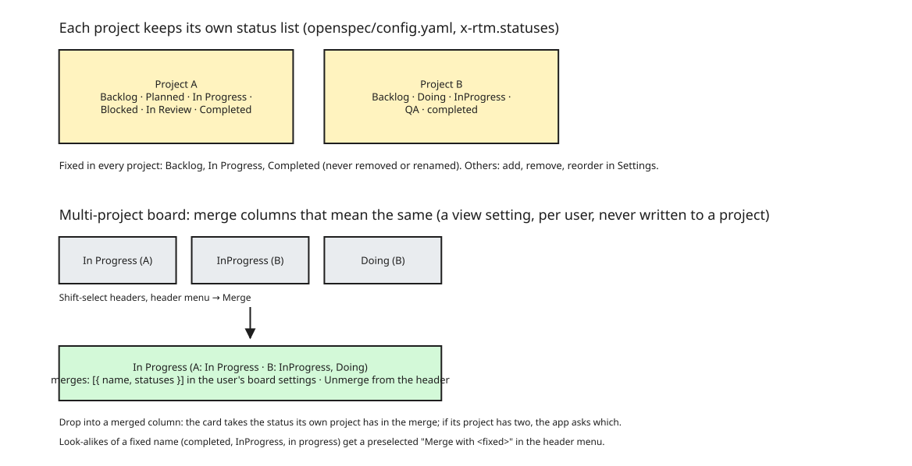

# Per-project statuses and merging look-alike columns (#wi171)

Status: built and verified in the hidden app (chunk "statuses", Claude); uncommitted in the worktree `wt-statuses`, for review. The drawing is the supervisor's to add.

## Why

The status list was one built-in list for every project (`WorkItemsApi.Statuses`). The owner wants three things:

1. Backlog, In Progress and Completed always remain; the other statuses can be added and deleted per project.
2. Projects spell the same status differently (`completed`, `Completed`, `InProgress`, `in progress`). In the multi-project board he wants to Shift-select several status columns, say they mean the same thing, and see them as one column ("merge").
3. The merge must not rewrite any project's own files: it is how *he* looks at the board.

## What the industry does

| Tool | How statuses are defined | What it teaches us |
|---|---|---|
| Jira ([status categories](https://support.atlassian.com/jira-cloud-administration/docs/what-is-a-workflow-status/), [community answer](https://community.atlassian.com/forums/Jira-questions/Can-we-edit-the-Status-Category-field-so-it-aligns-one-to-one/qaq-p/3192419)) | Any number of custom statuses per workflow, each mapped to one of three fixed categories: To Do, In Progress, Done. Boards and reports group by category. | A small fixed core that everything maps into is the way to compare projects: our fixed Backlog / In Progress / Completed play that role, and the merge is the (per-user) mapping of look-alikes into one column. |
| Linear ([configuring workflows](https://linear.app/docs/configuring-workflows)) | Statuses belong to a team; each has a *type* (backlog, unstarted, started, completed, canceled). Custom statuses are added under a type. | Statuses are per team (= per project here), and some are structural and cannot go. Linear keeps the mapping in the status definition; we keep it in the view because the projects are separate repositories we do not own. |
| GitHub Projects ([single select fields](https://docs.github.com/en/issues/tracking-your-work-with-issues/using-issues/managing-issue-fields)) | The Status field is a single-select with up to 50 options: add, rename, recolour, reorder, delete. | An ordered list of names edited in the project's settings; the board's columns are that list in order. |

None of the three merges equal-looking names across projects, which is the new part here; we do it as a saved view setting (like hidden columns).

## Decisions

1. **Where the list lives.** Each project's `openspec/config.yaml`, `x-rtm.statuses`, an ordered list of names. Missing means the built-in default list (`Backlog, Planned, Confirmed, In Progress, Blocked, In Review, Completed`). Backlog, In Progress and Completed are fixed: if a hand edit leaves them out they are put back, and the app cannot remove or rename them. Completed still means archived.
2. **Names.** Compared exactly (case and spaces matter): a project may list `completed` beside `Completed` (that is what the merge is for); only an exact duplicate is refused. Names are one line, at most 40 characters.
3. **Removing.** Only non-fixed, and only when no item has it; otherwise Settings offers to move those items to a chosen status first, then removes.
4. **Readers.** The board's columns, the list's groups, the status pills, the Create and SetStatus commands and the MCP tools read the project's list; `board_update`'s error names the project's allowed statuses. An item whose status is not in its project's list (a pull brought it) shows in Backlog, as an unknown status always did.
5. **Merge is a view setting.** `BoardOptions.Merges: [{name, statuses:[...]}]` in the per-user settings file, per board, like the hidden columns. It never touches a project's config. Matching is by exact status string per project.
6. **Merge in the UI.** In the multi-project board (status columns) Shift-click two or more column headers, then the header menu offers "Merge"; the merged column takes the first selected name (or a typed one) and holds the items of all merged statuses in every project. "Unmerge" on the merged header splits it again. The columns of several projects with different lists are aligned by the union of their statuses (first project's order first), so one shared header row serves all.
7. **Drop into a merged column.** The card's project is asked which of its statuses to use when it has more than one in the merge; with one, that one; with none, a message.
8. **Look-alikes of the fixed three.** A status that equals Backlog / In Progress / Completed ignoring case, spaces and dashes (`completed`, `InProgress`, `in progress`) gets "Merge with Completed" in its header menu, and the fixed column gets "Merge look-alikes": one click, no selecting.

## Chunks

| # | Chunk | Test (unit) | Black-box check |
|---|---|---|---|
| 1 | WorkItems: read and write `x-rtm.statuses`, fixed three, remove-with-move, SetStatus / Create / item read use the project list | ReadingWorkItemsTests, EditingWorkItemsTests | config.yaml in a demo repo, item moves |
| 2 | MCP and agent guide: validation and errors from the project list | UsingTheBoardOverMcpTests | `board_update` with an unknown status names the list |
| 3 | BoardModel: columns from a list, union across projects, merges, look-alikes | ArrangingTheBoardTests | - |
| 4 | Settings store: `BoardOptions.Merges` saved per board | RememberingSettingsTests | settings.json after a merge |
| 5 | Settings page: status list per project (add, remove, move, reorder) | UsingThePagesTests | hidden app, light and dark shots |
| 6 | Board: Shift-select headers, Merge / Unmerge / Merge look-alikes, drop into a merged column, pills with the project's statuses | UsingTheBoardTests | hidden app, two demo projects, one with `completed` |

One agent did all six in this worktree (the chunks share the same few files). Reordering is by up and down buttons; dragging a status row is not built.

## Verification

- Fast suite once: `dotnet test TaskManager.Tests --filter "Category!=OpenSpecCli" --logger "trx;LogFileName=latest.trx"`.
- Hidden desktop (`tests/hidden-app.ps1`, port 9619), two demo projects, one with a lower-case `completed`: shots in light and dark of the Settings status list, the header menu with Merge and the merged column, in `tests/out/shots/statuses-*`.
- Delta specs on #wi171 for `organise-work-items` and `integration-with-agents`.
