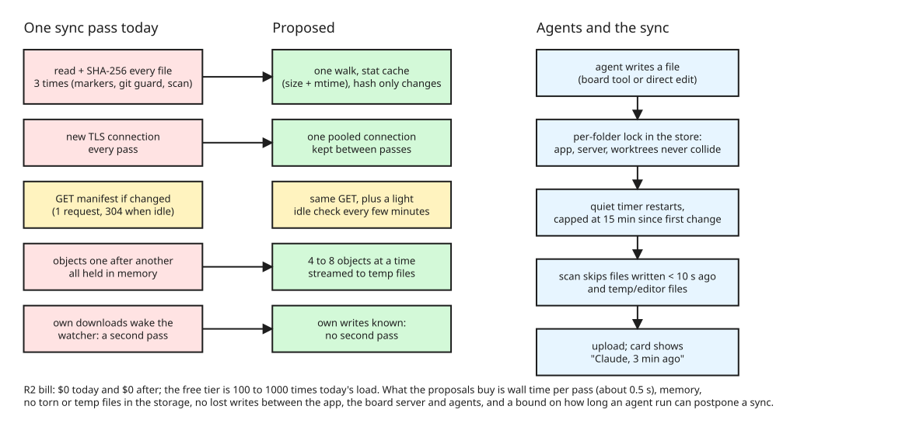

# Board sync: cheaper passes, and safe while agents work, 16 Nov 2026

- **Status:** built 2026-11-16, all six chunks integrated into the main tree, uncommitted, items #wi169 and #wi170 In Review. Three follow-ups came out of the suite runs and are in too: no real timers under the test assembly, shared reads of board and state files with atomic state writes, and a test helper that awaits every pass it starts. Not done: tombstone pruning (decision 6, second half) and a per-field clock.
- **Date:** 2026-11-16
- **Author:** Claude (agent), from two read-only research passes over the code and the web
- **Work items:** the two items filed with this plan (sync passes; agent safety); builds on #wi160 and #wi163

## Why

"i need you to thoroughly research if what we are doing is the most optimal way. we should aim for minimising our api usage and sync speed. On a separate note, i am worried how this behaves during agentic work: what happens if an agent takes longer than 2 minutes, then we sync multiple times work that is still in progress; what happens when multiple agents work on the same file. we need to come up with some locking mechanism."

## What a pass costs today (facts from the code)

| | Requests to R2 | Local work |
|---|---|---|
| Idle, nothing changed | 1 conditional GET per manifest (board + attachments), both answered 304 | every board file read and SHA-256 hashed three times (marker repair, git guard, scan); every attachment read and hashed; state.json and seen.json parsed |
| k files changed here | k PUTs (if absent) + 1 manifest PUT (if-match) | as above |
| k files changed on the other computer | 1 manifest GET + k object GETs; then the sync's own writes wake the watcher and schedule a second, idle pass | as above, plus a trash copy and a re-hash per written file |
| Archive one item (f files) | f + 1 PUTs (keys include the path, so a move re-uploads) and f GETs on the other side | f tombstones kept for ever |

- Every pass opens a new HTTPS connection (`S3Storage` is built per pass and never pooled or disposed).
- Objects are sent and fetched one after another; downloads sit in memory until the end of the pass.
- The manifest is indented JSON with 20 history hashes per path and tombstones that never expire: about 22 KB today, about 600 KB at maturity (estimate).
- Exit sync already runs only when a wait is pending; the manifest is put only when something changed; `List` is never used.
- An idle computer never polls: it learns about the other computer's edits only on start, exit, its own change or Sync now.
- Measured on this repository (711 files, 821 KB): one read-and-hash scan 55 ms warm, 160 ms cold; a stat-only walk 8 to 19 ms. A pass spends about 0.15 to 0.5 s in local scans before the first request.

**Cloudflare R2 bill** (prices from developers.cloudflare.com/r2/pricing): Class A (PUT) $4.50 per million after 1 M free, Class B (GET) $0.36 per million after 10 M free, egress free. Two computers, 300 board files, 200 attachments, 40 passes a day each: about 5,000 Class A and 11,000 Class B a month, 0.5 % and 0.1 % of the free tiers. **$0 now, $0 after any change below.** Polling the manifest every 30 s all day on both computers would still be under 2 % of the free tier.

So the request count is not the thing to optimise. The waste is wall time per pass, memory, manifest bytes, and that an idle computer hears nothing.

## What happens with agents today (facts from the code)

- **Longer than two minutes.** Every write an agent makes, through the board tools or by editing files, reaches the app's file watcher and restarts the two-minute timer. An agent that writes at least every two minutes postpones the sync without limit. One that goes quiet for two minutes gets whatever is on disk uploaded. Start, exit and Sync now ignore the timer. A mid-work upload is never overwritten later: the other computer downloads the newer version on its next pass.
- **What a mid-work upload contains.** Whole files as they are at that instant: a half-ticked tasks.md, a torn YAML if a direct editor is not atomic, and the store's own `<file>.tmp` if the scan lands inside its write-then-rename (the scan has no ignore list; only its own `.rtm-sync-tmp` is skipped).
- **Several agents on one file.** All board-tool calls on one machine go through one `--serve` process behind one gate, so they cannot lose each other's writes; id allocation holds an OS lock across worktrees. The gaps are between that server, the desktop app and direct edits: the store's write is check-then-rename with no lock in between, `events.log` is rewritten whole and a refused append is dropped silently, and two processes share one fixed temp name.
- **The stale trap.** A direct edit (not through the app or the board tools) that restores content the path has had before is treated as stale and reverted by the sync. The same edit through the board tools is safe.
- **Newer-wins is per file, not per field.** A long agent session's last write makes its earlier field edits "newer" than another computer's later edit of the same field.

## What the industry does (sources)

- **git**: a stat cache (size, mtime, inode) decides what to re-hash; the racy-git rule re-reads files whose mtime is not older than the index. Locks only its own metadata with exclusive `.lock` files; never locks working files. https://git-scm.com/docs/racy-git
- **Syncthing**: watcher events batched 10 s, hourly rescan compares size and mtime and re-hashes only changed blocks; writes to a temp file then renames; defers a file that changed since its scan; conflicts keep both copies. https://docs.syncthing.net/users/syncing.html
- **rclone**: size + modtime by default, hash on demand; `--fast-list` to cut list calls; on S3 a modtime costs a HEAD per object, so it recommends size-only or checksum modes. https://rclone.org/docs/
- **Joplin**: per-item sync table; on S3 it lists the whole target (slow); its sync locks (files with TTL and refresh) exist for target upgrades, not ordinary writes, and clock skew and leftover locks are a known pain. https://joplinapp.org/help/dev/spec/sync_lock
- **Obsidian Sync**: no locks; three-way merge of markdown, last-modified-wins for the rest. https://help.obsidian.md/sync/troubleshoot
- **Leases on object storage**: create-if-absent with `If-None-Match: *`, renew with `If-Match`, TTL and heartbeat; Kleppmann's point that a lease alone is unsafe without a fencing token. Our manifest `If-Match` is already that fence. https://martin.kleppmann.com/2016/02/08/how-to-do-distributed-locking.html
- **S3 practice**: one manifest with conditional GET is one Class B request at any size; listing is Class A per 1000 keys. R2 evaluates `If-Match`/`If-None-Match` atomically on GET and PUT. https://developers.cloudflare.com/r2/api/s3/api/
- **Agent frameworks**: no file locks; one worktree per agent, file ownership in briefs, optimistic revision checks (what `board_update revision` already is). Claude Code's `PreToolUse` hooks can deny a tool per path. https://code.claude.com/docs/en/hooks

Verdict on the architecture: one manifest, conditional GET and PUT, immutable objects is the right family and cheaper than Joplin or rclone on S3. Nothing needs a storage-layout migration.

## Decisions proposed

**Sync passes**

1. **One pooled connection** across passes; `S3Storage` becomes disposable and is cached per address. Saves a TLS handshake per pass (about 0.1 to 0.3 s).
2. **One walk with a stat cache** (size, mtime, hash per path, git's racy rule), shared by the scan, the git guard, the marker repair and the Settings status line. No bytes kept in memory. Saves three to four full read-and-hash scans per pass; attachments stop being re-read every pass.
3. **No second pass after the sync's own writes**: the engine reports what it wrote, the service ignores those watcher events but keeps the UI refresh.
4. **A light idle check**: a conditional GET of the manifest every 60 s while the window is focused, every 5 min when not, with jitter; a full pass only on a 200. This is the one change that adds requests (0.3 to 0.5 % of the free tier) and it fixes the real gap: an idle computer never hears about remote edits today.
5. **Parallel object transfer**, 4 to 8 at a time, downloads streamed to temp files; reuse a base copy with the same hash before a GET (archive moves then cost no downloads).
6. **Smaller manifest, same format**: compact JSON, history 20 to 3 (staleness is still covered by seen.json and the conditional PUT probe). Tombstone pruning later, after fixing the planner branch that dereferences a missing remote entry.

Rejected: content-addressed keys without the path (breaks the stale probe, needs a migration), a delta log (pays off above a 1 MB manifest), splitting the manifest per project (worse idle cost), scanning only watcher-touched folders (misses outside edits and attachments; a stat walk is 10 to 20 ms anyway).

**Agents**

7. **Settle window and ignore list** in the scan: a file written less than 10 s ago is left for the next pass (like links and oversized files today), capped at 5 min of deferral; `*.tmp`, `~$*`, `*.swp`, `.#*`, `*~`, `.rtm-*` are never synced. No torn or temp file reaches the storage.
8. **Postponement cap**: the quiet timer still restarts on every change, but never past 15 min after the first unsynced change. A two-hour agent run syncs about every 15 min; a crash loses at most that.
9. **Per-change-folder lock in the store** (OS `FileShare.None` lock file under the git common dir, 5 s wait, dies with the process), held across check, temp write and rename; unique temp names; `events.log` appended under the lock instead of refused. Closes every lost-update window between the app, the board server and worktrees on one computer. Agents call nothing new.
10. **A hook that denies direct edits under `openspec/changes`** for agents while the board tools are loaded ("use board_*"). Enforces the CLAUDE.md rule and keeps agents out of the stale trap.
11. **A badge on the card**: "Claude, 3 min ago" from the existing `agentBy`/`agentAt` stamp. Display only; no lease file, no TTL.

Rejected: holding an item back until its agent finishes (bigger merges, hides the progress the board exists to show); a lease file that sync honours (the same widening, plus TTL and clock-skew problems); a storage-side lock between computers (the manifest's compare-and-swap already prevents clobbering).

Not covered and said so: half-done state is visible on the other computer by design; two computers editing the same field inside one interval are still decided per file, not per field (a per-field clock is the later fix); ids allocated independently on two computers still collide and are renumbered.

## Chunks

| Chunk | What | Owner | Test |
|---|---|---|---|
| pass-1 | pooled connection; stat cache shared by scan, guard, repair, status | sonnet, worktree | `SyncingTheBoardTests`, new `ScanningWithAStatCacheTests` |
| pass-2 | no second pass after own writes; idle check with focus-aware interval | sonnet, worktree | `SyncingWithConnectedStorageTests` (fake clock) |
| pass-3 | parallel transfer, streamed downloads, base reuse; compact manifest, history 3 | sonnet, worktree | `StoringBoardFilesTests`, `SyncingTheBoardTests` |
| agents-1 | settle window and ignore list; postponement cap | sonnet, worktree | `SyncingTheBoardTests`, `SyncingWithConnectedStorageTests` |
| agents-2 | per-folder store lock, unique temp names, events.log append | sonnet, worktree | new `WritingTheBoardConcurrentlyTests` (two processes) |
| agents-3 | hook in `.claude/settings.json`; card badge | sonnet, worktree, hidden desktop | `UsingTheBoardTests` |

## Verification

- Fast suite green after each integration, one run each (baseline 976).
- A pass timed before and after on this repository and on a copy with 100 MB of attachments.
- Hidden desktop, light and dark: the badge; the Settings status line while a file is inside the settle window.
- Not possible here: a real R2 bucket under load; two physical computers.
