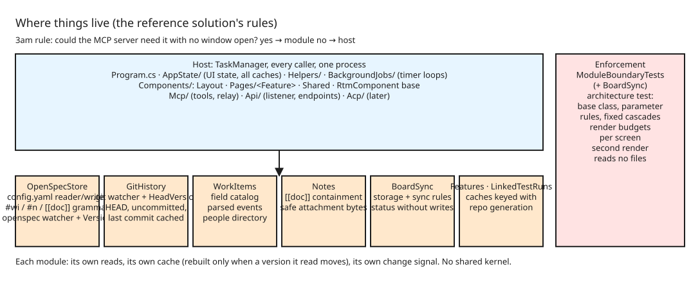

# One universal UI structure: rendering, caching and shared low-level functions

Status: **plan, awaiting the owner's approval.** Research is done: principles, open-source code, caching, the app map, a helper inventory, and measurements of every screen (the item page timed in the real app, the other pages counted in bUnit). Work item #wi180; it extends #wi179 ([list-render-cost-2026-11-16.md](list-render-cost-2026-11-16.md)).



## Why

The owner: "you need to come up with a more general model that would centralise any such issues in one spot and lets us address it once and for all … rendering, caching, and any reusable low level functions should be centrally managed. There are a bunch of other screens + some that we haven't even started building yet."

#wi179 fixed one screen by hand. The research shows the same three gaps under every screen:

- **Rendering is decided per component.** Blazor's own defaults are still in force everywhere:
  - redraw after every click handler, even when nothing changed;
  - treat every object, list, lambda or template parameter as changed.

  So bubbling clicks, per-row lambdas and new lists redraw whole subtrees. One click on the side menu redraws it twice with its 7 dropdowns. Board → list takes 420–501 ms. Letting go of an examined item makes 610 DOM changes.
- **Caching is ad hoc.** Some reads are cached by version, some by HEAD, one by a 2-second timer, and many not at all:
  - `config.yaml` is read in render paths, once per archived row and 6–9 times per repo on Settings;
  - git HEAD is read under every `GetAll`;
  - a file walk of `openspec/changes` runs on every examine;
  - images are base64-encoded on every keystroke in a note;
  - Settings writes a cache file to disk on every render.

  Two caches go stale after a repo is reopened, and nothing watches `.git`.
- **Low-level functions are copied.** Examples:
  - 8 `config.yaml` path builders and 7 YAML deserializers;
  - 3 image readers, 2 of them without the safety checks;
  - about 20 date formats and 4 different clocks;
  - 6 debounce variants and 7 retry loops;
  - 6 fold toggles, a subtask row drawn 4 ways, and 2 markdown editors.

  The same note renders differently on two pages.

## What current practice says (sources dated, 2024 or later unless marked)

- **Blazor will not skip renders for us.**
  - [ComponentBase.cs](https://github.com/dotnet/aspnetcore/blob/main/src/Components/Components/src/ComponentBase.cs) (main, read 2026-11-16) still calls `StateHasChanged` after every event.
  - [ChangeDetection.cs](https://github.com/dotnet/aspnetcore/blob/main/src/Components/Components/src/ChangeDetection.cs) trusts only primitives, strings, dates, enums, Guid and `EventCallback`. Records are always "changed".
  - Requests to change this were declined: [#40867](https://github.com/dotnet/aspnetcore/issues/40867), and the current source confirms it.
  - The [.NET 10 rendering-performance guide](https://learn.microsoft.com/en-us/aspnet/core/blazor/performance/rendering) (2026-04-28) teaches the same tools: `ShouldRender`, non-rendering events through `IHandleEvent`, fewer component instances, cached delegates and `Virtualize`.
  - `IHandleEvent` skips error boundaries. The documented fix is a base component that calls `DispatchExceptionAsync` ([#54543](https://github.com/dotnet/aspnetcore/issues/54543), fixed in docs for 9.0).
- **How current projects do it in code** (all read at their default branch, Nov 2026):
  - **Rows and cells as markup, not components:** [QuickGrid](https://github.com/dotnet/aspnetcore/blob/main/src/Components/QuickGrid/Microsoft.AspNetCore.Components.QuickGrid/src/QuickGrid.razor); Radzen removed its cell component.
  - **A version stamp gates a subtree:** [Oqtane `RenderId`](https://github.com/oqtane/oqtane.framework/blob/dev/Oqtane.Client/Modules/ModuleBase.cs) and [Excalidraw `sceneNonce`](https://github.com/excalidraw/excalidraw/blob/master/packages/element/src/Scene.ts).
  - **Selection kept apart from the data, with only changed keys told:**
    - [VS Code list `Trait`](https://github.com/microsoft/vscode/blob/main/src/vs/base/browser/ui/list/listWidget.ts) diffs old and new and toggles one class;
    - [Plane](https://github.com/makeplane/plane/blob/preview/apps/web/store/multiple_select.store.ts) uses per-id selectors;
    - [TanStack Table v9](https://github.com/TanStack/table/blob/main/packages/react-table/src/Subscribe.ts) replaced v8's whole-table re-render with per-row subscriptions.
  - **Events that do not render:** [FluentUI Blazor grid rows](https://github.com/microsoft/fluentui-blazor/blob/dev/src/Core/Components/DataGrid/FluentDataGridRow.razor.cs).
  - **A base component that owns subscriptions and render bookkeeping:** [TimeWarp.State](https://github.com/TimeWarpEngineering/blazor-state/blob/master/source/timewarp-state-blazor/components/timewarp-state-component.cs) and [Fluxor `IStateSelection`](https://github.com/mrpmorris/Fluxor/blob/master/Source/Lib/Fluxor/StateSelection.cs).
- **Caching:**
  - Microsoft's change tokens fire once each ([change tokens](https://learn.microsoft.com/en-us/aspnet/core/fundamentals/change-tokens?view=aspnetcore-10.0), 2026-11-03), and `IMemoryCache.GetOrCreate` is not atomic ([memory cache](https://learn.microsoft.com/en-us/aspnet/core/performance/caching/memory?view=aspnetcore-10.0), 2026-11-13).
  - [HybridCache](https://learn.microsoft.com/en-us/aspnet/core/performance/caching/hybrid?view=aspnetcore-10.0) (2026-11-13) is async-only and built for multi-server setups.
  - Build systems and editors cache derived values against the versions of their inputs and stop when a recompute gives an equal value:
    - [Roslyn incremental generators](https://github.com/dotnet/roslyn/blob/main/docs/features/incremental-generators.md) (2026-06-30);
    - [MSBuild](https://learn.microsoft.com/en-us/visualstudio/msbuild/incremental-builds?view=visualstudio) (2026-10-20);
    - [Salsa](https://salsa-rs.github.io/salsa/overview.html) (2026-06-30).
  - Git tools watch `.git` shallowly, debounce, and confirm with a fingerprint:
    - [VS Code git](https://github.com/microsoft/vscode/blob/main/extensions/git/src/repository.ts) (2026-11-15);
    - [lazygit](https://github.com/jesseduffield/lazygit/blob/master/pkg/gui/background.go) (2026-08-12).
  - [FakeTimeProvider](https://learn.microsoft.com/en-us/dotnet/core/extensions/timeprovider-testing) (2026-03-02) keeps timers deterministic in tests.

## Where things live

The structure follows the reference solution this repository is modelled on. Its rules are written in the BI solution's `local/plans/webui-frontend-assessment.md` and `webui-restructure-implementation-plan.md`, and enforced by its `ModuleBoundaryTests.cs` and by this repository's own `ModuleBoundaryTests.cs`. Every placement below follows one of them:

1. **The 3am rule.** "Could a background job call this at 3am with nobody logged in?" Here the background caller is an agent's MCP call (no one at the window).
   - Yes → it belongs in the module that owns it, behind `{Module}Api`.
   - No → it belongs in the component's `.razor.cs`, or in host `AppState/` when it is per-user state.
2. **No cross-cutting infrastructure.** Each module runs its own infrastructure: its own file reads, its own cache, its own change signal. There is no shared kernel and no shared cache library. A module keeps its own small internal copy unless sharing genuinely saves real work.
3. **One function per rule, in the module that owns it.** Grepping a rule finds one definition.
4. **The host has no `Services/` and no `Infrastructure/` folder:**
   - `Program.cs` for composition;
   - `AppState/` for per-user state, as plain typed accessors with no abstraction and no interface;
   - `Helpers/` for everything shared in the host;
   - `BackgroundJobs/` for timer loops only;
   - `Components/` for UI components and pages, `.razor` plus `.razor.cs`.
5. **No MVVM framework, MediatR or store library.** The `{Module}Api` seam is the application layer, and a second indirection would compete with it.

### Modules: each owns its rules, its files and its change signal; no caches

Modules read and write their files and say when they changed, as a version number on their Api. They keep no caches. All caching lives in host `AppState/` (below).

| Module | Takes on (all pass the 3am test: the MCP server needs them too) | Replaces |
|---|---|---|
| **OpenSpecStore** | The single reader and writer of every `x-rtm` section of `openspec/config.yaml`, defaults included.<br>The `#wiN` / `#nN` / `[[doc]]` grammar, parsed and formatted: it owns the board's file format.<br>Own-write echoes recognised by content (its `LastSeen` map), not by the 1.5 s time window; `LastSeen`, `OwnWrites` and `Touches` pruned.<br>The `.gitignore` / `.gitattributes` rule lines (`WorklogTracking`, `GitAttributes`) and the `REPO-TASKS.md` guide (`AgentGuide`) move in from host `Services/`. | 8 `config.yaml` path builders (2 in host `Services/`), 7 deserializers, `BoardStorage.SectionOf` and `SettingsStore.WriteProjectKey` copies. About 10 reference regexes with 3 boundary rules, including MCP's `BoardTools.cs:579`. Two "append a rule line" helpers. |
| **GitHistory** | A shallow `.git` watcher (HEAD, index, packed-refs, `refs/`; ignores `*.lock`) and a `HeadVersion` on its Api.<br>The uncommitted set and the last commit as plain reads. | Nothing noticing a commit or checkout. `BoardModel.Uncommitted` and `LastCommit` become calls to it. |
| **WorkItems** | The field catalog: statuses, lanes, labels and priorities per project, plus status order.<br>Events parsed into PublicDTOs, so the UI stops parsing event text.<br>The people directory: contributors plus git authors (injected by the host, like `Git` today) plus me, canonicalised once.<br>Duplicate-id repair, moved here from `Workspace.Notify`. | the built-in status order in `BoardModel` and `AnalyticsModel`, the two event-text switches in `Worklog.razor`, 6 people lists |
| **Notes** | `[[doc]]` resolution with a containment check (it currently allows `..`).<br>Attachment bytes read safely: containment, junction check, size cap. | 3 image readers, 2 of them without the checks |
| **BoardSync** | The storage providers and storage config from host `BoardStorage.cs`, and the sync rules from `BoardSyncService.cs`. Status is computed without writing. | A disk write on every Settings render. |

The module caches that exist today move out to `AppState/`: WorkItems' `RepoCache`, Notes', Features', LinkedTestRuns' and GitHistory's per-HEAD caches. This also removes the two stale-after-reopen bugs (Features and LinkedTestRuns), because the new caches key on the repo's generation.

### Caching (`AppState/`)

All caching lives in `AppState/`, the same place the reference keeps `InvoiceSnapshotStore`, `BankCacheEntry` and `RemittanceCacheEntry`, and where its restructure plan puts typed cache keys.
- **One cache class per kind of data,** with plain typed accessors and no abstraction or interface: items, notes, features, config sections, git state, events per item, test results, rendered markdown, images.
- **A cached value remembers the module versions it was read at** (OpenSpecStore `Version`, GitHistory `HeadVersion`, the repo generation, a file stamp). It is read again only when one of them moves.
- **When the new value is equal,** the cache keeps the old instance, so components see no change and don't redraw.
- **Components read data only through these caches,** never from a module directly in a render path.
- **The MCP server** calls module Apis per request, not per redraw, so it reads without a cache. This is the one consequence of keeping caching out of modules, and it doesn't matter at agent call rates.

### Host (TaskManager): every caller, one project, one process

Decided by the owner (16 Nov 2026):
- **One caller project.** Every caller lives in `TaskManager`: the GUI, MCP, the HTTP API, and later ACP. `TaskManager.Mcp` merges in.
- **One process.** The app hosts the MCP endpoint itself, and "Separate window" opens a window in the same process. The only other process is the `--mcp` relay. The agent starts it, and it holds no logic: it forwards to the app, and answers "open the app" when the app is closed, as it does today.
- **The folders.** The reference's four folders, plus one folder per non-UI caller (`Mcp/`, `Api/`, `Acp/`). This is how large Blazor hosts do it: Aspire Dashboard (`Api/`, `Otlp/`), bit Boilerplate (`DevMcp/`), Oqtane (`Controllers/`, `Jobs/`). None of them puts callers under `Components/`.

```
TaskManager/
  Program.cs          mode switch (app | --mcp relay); calls each folder's Add*/Map*
  AppState/           per-user state and all caching
  Helpers/            host code shared by more than one caller
  BackgroundJobs/     timer loops only
  Components/         the GUI caller
    Layout/           MainLayout, SideNav
    Pages/<Feature>/  one folder per page area: the page (+ partial .razor.cs per concern), its child components, its view model
    Shared/           components used by two or more pages
  Mcp/                the MCP caller: tools, DTOs, setup, the --mcp relay
  Api/                the HTTP caller: the listener (token, origin, /health, server.json), REST endpoints later
  Acp/                later, same shape as Mcp/
```

| Folder | Holds | From |
|---|---|---|
| `Program.cs` | composition: `Configure` the modules and inject what one needs from another; picks the mode; starts the window and the listener | `Program.cs` |
| `AppState/` | **UiService**: selection, examine, layout and worklog filters as immutable records, with plain typed accessors and a keyed change event. Shift-click tells only the 1–2 rows whose keys changed. **Per window.**<br>**Workspace**: open projects, with its change event saying which project changed. Its notices become an event, not a call into UiService. **Shared by all windows.**<br>**SettingsStore**: per-machine settings plus a revision number.<br>**AppMode**, **BoardOptions**.<br>All caches (above). | `Services/UiService`, `Workspace`, `SettingsStore` (minus the rules that move into modules), `AppMode`; `BoardOptions` from `Board/BoardModel.cs` |
| `Helpers/` | `Ui.cs`: date and period formats on one injected clock, colours, and markdown to HTML (using Notes' safe attachment bytes and OpenSpecStore's reference grammar). Toast, confirm and JS-call helpers. Window and OS adapters (frame, pickers, folder and editor openers). `Paths`, `RunMarker`, crash log. | `Components/Ui.cs`, today's 20 inline formats, 4 colour copies, NotePage's own Markdig, repeated toast flows and JS exception lists, `Services/WindowFrame`, `FilePicker`, `FolderPicker`, `FolderOpener`, `EditorLauncher`, `Hosting/Paths`, `RunMarker` |
| `BackgroundJobs/` | the sync timer loop | the timers of `Services/BoardSyncService` (its rules go to BoardSync) |
| `Components/` | layout, page folders, shared components, the base component. View models (`BoardModel`, `RoadmapModel`, `AnalyticsModel`) sit in their page folder, minus their git and event rules. | `Components/`, `Board/` |
| `Mcp/` | the 8 tools as thin calls into module Apis, split into partials (read, write, validate); `BoardDtos`; setup (`AddBoardMcp`, `MapBoardMcp`, instructions, caller context); the `--mcp` relay | `TaskManager.Mcp/*`, `Hosting/McpShim` |
| `Api/` | the loopback listener in the app process (Kestrel, token, origin check, `/health`, `server.json`, a refusal when another instance already listens); the Settings status line; REST endpoints later, one `Map…` per area | `Hosting/ServeHost`, `McpServerControl` |
| `Acp/` | later | — |

`Services/`, `Hosting/`, `Board/` and the `TaskManager.Mcp` project disappear. These go away entirely: `--serve`, `--parent`, idle exit, `/shutdown`, spawning and replacing the server, `server-writes.log`, and Settings' Start/Stop.

**Domain rules leave the callers.** By the 3am rule they move into the owning module:
- **From `BoardTools.cs`:**
  - about 20 rules, including creation statuses, folder naming, "Completed refused for agents", `IsReady`, the `tasks.md` format and signing, note composition, test-name checks and capability checks;
  - finding the repository from a path, which goes to OpenSpecStore.
- **From the host:**
  - duplicate-id repair, written twice;
  - the worklog feed assembly, written twice (`Worklog.razor` and `BoardTools`);
  - status history from events (`AnalyticsModel`) and "changed in period" (`BoardModel`);
  - sync-conflict notes.

### One process: what has to change first

The modules keep **one current repository per process** (`OpenSpecStore` `Current`, GitHistory `RepoRoot`), and `Workspace.In` swaps it without a lock. The UI, the file-watcher timer and sync passes already race on it today. An MCP call or a second window on another repository would switch it under the open window. So before the listener or any window moves in-process:
1. **The repository travels with each call.** It moves from the global into the call, either as an AsyncLocal overlay (the same mechanism as the test `Isolated` seam) or as an explicit root. This also fixes today's race.
2. **The author ("actor") travels with each call.** Today a tool call sets it to the agent's name and then to null, which inside the app would sign your edits as the agent, then as nobody.
3. **Locks on the three unlocked caches** (Features, GitHistory states, LinkedTestRuns) until they move to `AppState/`.
4. **A tool call that wrote raises the change event.** In one process an agent's writes count as the app's own, so the file watcher ignores them and the window would never refresh.
5. **The stale-write guard is per caller,** so a screen edit can't silently overwrite an agent's edit.
6. **A tool call never adds a repository to the open set.** Today it does (`Open(keepOthers: true)`).

**Windows in one process** (Photino.Blazor 4.0.13, the current release, has no multi-window API; this is the pattern its maintainers point to, issues #150 and #153, 2025):
- one `PhotinoBlazorApp` per window, always created on the UI thread;
- shared singletons (Workspace, SettingsStore, sync) handed to every window;
- per-window UiService, frame and pickers.

Known costs:
- closing the first window closes all of them;
- a closed window's services are never disposed (open issues #149 and #158);
- shared events must redraw through each window's own `InvokeAsync`.

PhotinoX.Blazor (a fork with real multi-window support) is the fallback if this proves fragile. Switching to WPF's `BlazorWebView` is not, because of its open .NET 10 drag regression (maui #36128).

**Rule: no file, git or process call in a render path.** Components read module Apis, which answer from their caches. In Debug builds the base component marks render time, and a test renders every screen against a repository whose files are locked, to catch an uncached read.

### Shared components (`Components/Shared`)

This is the reference plan's "phase 5, shared component" applied to every duplicated block. Each building block is written once:
- with value-type or stamped parameters, so it skips redraws by construction;
- with no per-row components inside lists;
- with editors only on demand.

The kit also holds:
- `RenderBoundary(Version)`: draws its content only when its version changes. It wraps the Radzen grid and the card board.
- `RowMarks`: applies selection and examine as one `<style>` rule per marked row, outside the grid.

New screens are assembled from the kit. A one-off variant has to be added to the kit instead.

### The base component (`Components/RtmComponent.cs`)

The reference solution has no base component; it relies on `.razor.cs` partial classes. Render control has no other single place in Blazor, so this is the one addition. It passes the rules: it is UI-only (fails the 3am test), lives in the host, and adds no layer between pages and module Apis. Every `.razor` gets it through `@inherits` in `_Imports.razor`, and code-behind stays `.razor.cs` partial classes.

```csharp
public abstract class RtmComponent : ComponentBase, IHandleEvent, IDisposable
{
    // 1. events never redraw by themselves; Invalidate() when local state changed
    Task IHandleEvent.HandleEventAsync(EventCallbackWorkItem cb, object? arg) => /* await, catch → DispatchExceptionAsync */;
    // 2. skip a parameter-set redraw when the key is unchanged (null = today's behaviour)
    protected virtual object? RenderKey => null;
    // 3. subscriptions, disposed with the component, coalesced, marshalled with InvokeAsync
    protected T Select<T>(Func<UiState, T> part);   protected void Watch(string key);   protected void OnVersion(Func<long> version);
    // 4. render counter per type (behind the AsyncLocal test seam) and the Debug render scope
}
```

`RepoPage` becomes a subclass that adds `LoadKey` and coalesced reloads, and SideNav, ExaminePanel and the Settings sections now use it too.

### The contract every screen follows

1. Derive from `RtmComponent` (or `RepoPage`).
2. Handlers call `Invalidate()` only when they changed something the component shows. Shared UI state changes go through UiService.
3. Parameters are value types, method groups or cached callbacks. Records passed in are covered by `RenderKey`. Templates go only to components that appear once per screen. Cascading values are `IsFixed`.
4. No IO in a render path. Data comes from the `AppState/` caches, which read module Apis only when a version moved.
5. Lists render rows as markup, wrapped in a `RenderBoundary`. Marks go through `RowMarks` or keyed `Watch`. Editors open on demand.
6. Rules come from the owning module (the 3am rule). Display text (dates, colours, markdown) comes from `Ui.cs`. Nothing is written inline.
7. Each screen has a render-budget test named by what the user does.

## Enforcement

- **Architecture test.** Reflection over the TaskManager assembly checks that:
  - every component we own derives from `RtmComponent`;
  - parameter types follow rule 3, or the component has a `RenderKey`;
  - there are no non-fixed cascading values.

  An allowlist lists the components not yet migrated and shrinks with each chunk. A new screen can't be added off-model.
- **Render budgets.** One helper, `AssertRenders(interaction, (Type, max)[])`, reads the base class counters, for example "list examine: BoardPage 1, grid rows 0, RowMarks 1". It uses no timings; coalescing goes through `FakeTimeProvider`.
- **IO guard.** A test renders every screen twice against a fixture repository. The second render must not read a file: the module caches answer.
- **AppState cache tests**, named by user action. Each cache must:
  - rebuild only when a version it depends on moves;
  - not notify when a rebuild gives an equal value;
  - not lose a change made during a rebuild;
  - re-check everything after a watcher overflow.
- **Module boundaries** stay enforced by the existing `ModuleBoundaryTests`. BoardSync joins its module list.
- **Hidden-desktop timing** per migrated screen, with a target under 100 ms per click.

## Decisions and what they rule out

- **No shared kernel. Caching lives in `AppState/`, not in modules.** Modules own rules, files and change signals (reference rule: no cross-cutting infrastructure). The host injects across modules as it does today.
- **No Fluxor, TimeWarp, ReactiveUI, MVVM framework or MediatR.** UiService in `AppState/` is the UI state, with plain typed accessors. The module Apis are the application layer (reference rule).
- **Version counters inside each module, not change tokens, IMemoryCache or HybridCache.** Tokens lose changes at re-registration, `GetOrCreate` can stampede, and HybridCache is async-only and built for multiple servers.
- **No signal-tracking interceptor** (Namotion.Interceptor, 2026-10). It reaches private framework members and would break on patches.
- **One base component** in the host. This is the only addition beyond the reference, and the reason is given above.

## Bugs found along the way (fix first, each its own small chunk)

1. **Image reads without the safety checks:** `Worklog.razor:999-1007` and `NotePage.razor:248-249` skip the junction check and size cap that `Ui.ImageSrc` has. *Security.*
2. **Settings writes to disk on every render:** `BoardStorageSection.razor:8` → `Sync.Status` → `GitPause` saves the stat cache and walks for conflict markers.
3. **Archived list rows read `config.yaml` per row and use the active project's statuses** (`BoardPage.razor:122`).
4. **Stale caches:** the Features and LinkedTestRuns caches ignore the repo generation and serve old data after a repo is reopened. LinkedTestRuns also uses `DateTime.UtcNow`, and both dictionaries are unlocked.
5. **Nothing watches `.git`:** after a commit or checkout, contributors, uncommitted dots and "last commit" stay stale until the next openspec edit.
6. **The same note renders two ways:** NotePage links `#wi`/`#n`/`[[doc]]` but drops images; Worklog and DocPage show images but don't link.
7. **Opening a list pill with the side menu expanded also examines the row,** because the click bubbles to the row handler.
8. **A raw NUL byte in `BoardPage.razor.cs:762`** (`"\0all"`) makes search tools treat the file as binary.

## Chunks

Each chunk is testable alone: a unit or bUnit test plus a hidden-desktop check where there is UI. Phase 0 and phase 1 can run in parallel.

| Phase | Chunk | What | Test |
|---|---|---|---|
| 0 | bug-images | route both readers through `Ui.ImageSrc` | a junction or oversized image is refused in Worklog and NotePage |
| 0 | bug-settings-io | `Sync.Status` answers from BoardSync's state, never saves | render Settings 3×: no file writes |
| 0 | bug-archived-pill | archived rows use the row's own project statuses, cached | two projects with different statuses |
| 0 | bug-stale-caches | interim fix until the caches move: generation in the Features/LinkedTestRuns keys, `TimeProvider`, locks | reopen a repo: new data |
| 0 | bug-pill-examines | a pill click does not reach the row handler | pill click with the menu expanded: nothing examined |
| 0 | bug-nul | replace the NUL sentinel | grep finds text in the file |
| 1 | openspecstore-config | `config.yaml` reader/writer and the reference grammar in OpenSpecStore; own-write echo by content; prune its maps | one reader for every section; MCP and UI parse `#wi12` the same |
| 1 | githistory-watch | shallow `.git` watcher, `HeadVersion`, uncommitted set and last commit | a commit bumps `HeadVersion` without an openspec edit |
| 2 | appstate-caches | one cache class per kind of data in `AppState/`, keyed on module versions; module caches moved out | a second screen render reads no file; an equal reload keeps the same instances |
| 1 | per-call-repo | repository and author travel with each call (AsyncLocal overlay or explicit root); no tool call adds to the open set; locks on the 3 unlocked caches | a UI load on repo A while a tool call writes repo B: each sees its own repo, the UI edit is signed by me, nothing switches |
| 1 | base-class | `RtmComponent` in legacy mode (renders as today), counter, render scope, architecture test with a full allowlist | every component derives from it; budgets readable |
| 1 | ui-text | `Ui.cs` owns every date, period and colour format on one injected clock | one table of formats; no inline format strings left |
| 2 | workitems-catalog | field catalog, parsed events, people directory, duplicate-id repair moved in from Workspace | Worklog has no event-text parsing; one people list |
| 2 | notes-safe-files | `[[doc]]` containment, safe attachment bytes; `Ui.cs` markdown uses them | a junction or oversized image is refused everywhere; one note renders the same on three screens |
| 2 | boardsync-move | storage providers and sync rules from host `Services/` into BoardSync; the timer loop into `BackgroundJobs/` | sync behaves as before; BoardSync added to the boundary tests |
| 2 | host-folders | `Services/`, `Hosting/` and `Board/` dissolved into `AppState/`, `Helpers/`, `BackgroundJobs/` and `Components/`; UiService gets immutable state and a keyed change event; Workspace gets the changed-project event | Shift-click notifies only the changed keys; a change in project A doesn't reload project B's page |
| 2 | callers-to-modules | the ~20 rules in `BoardTools.cs` and the host's duplicate repair, worklog feed, status history and sync-conflict notes move into their modules | MCP and the UI give the same answer from one module call; grep finds one definition per rule |
| 2 | mcp-merge | `TaskManager.Mcp` merged into `TaskManager/Mcp/`, tools thin; `Api/` listener inside the app process; `--serve`, `--parent`, idle exit, `/shutdown`, spawn and replace removed; writes raise the change event; second instance refuses the port | `--mcp` relays to the app; app closed → "open the app"; an agent's write shows in the window |
| 2 | windows-in-process | "Separate window" as a second `PhotinoBlazorApp` on the UI thread; shared and per-window services split; Workspace notices as an event | two windows, one process; a toast shows only in its own window; hidden-desktop check in both windows |
| 2 | host-layout | `Components/` into `Layout/`, `Pages/<Feature>/` (view models co-located) and `Shared/`; big pages split into partial `.razor.cs` files per concern | build and full suite green, no route changes |
| 3 | screen-list | `RenderBoundary` around the grid, `RowMarks`, strict events, stable rows | examine/select: 0 grid row renders; board → list < 150 ms |
| 3 | screen-sidenav | strict, `Select`, option blocks kept alive while examining, lazy folded sections | menu click: SideNav 1, dropdowns 0; let-go < 50 mutations |
| 3 | screen-board | cards with `RenderKey` and keyed marks, non-rendering header handlers | examine: 2 cards render, not all |
| 3 | screen-pages | Worklog, WorkItemPage, NotePage/DocPage, Roadmap/Analytics, Settings: strict, memo reads, typing redraws the editor only | per-page budgets from the measurements |
| 4 | ui-kit | FoldToggle, SectionHeader, Tile, KeyValue, EmptyState, MenuItem (disabled), SubtaskRow, ItemRef, AttachmentList, AddLineInput, ColumnHeaderMenu, Commit/Feature/ProjectPicker, MarkdownEditor | each used by every screen that had a copy |
| 5 | cleanup | drop the event adapters and the allowlist; the architecture test runs with no exceptions | the architecture test passes with the allowlist empty |

## Progress (16 Nov 2026)

- **Done and In Review:**
  - #wi181 per-call repository and author;
  - #wi182 the phase-0 bugs, plus a merge/note-reader race;
  - #wi183 the base component;
  - #wi184 one `config.yaml` reader and one reference grammar;
  - #wi185 the `.git` watcher;
  - #wi186 dates and colours;
  - #wi187 rules out of the callers;
  - #wi189 the list on RenderBoundary and RowMarks.
- **Done 17 Nov:** #wi188 one process (separate windows in-process; `TaskManager.Mcp` merged into `TaskManager/Mcp/`, listener in `TaskManager/Api/`, `--serve`/spawning removed); #wi190 side menu (first expand 43 ms, let-go 8 mutations); #wi191 board view (examine redraws 1–2 cards); pages (worklog typing, note HTML cache, roadmap click keeps examine); caches into `AppState/` (modules keep none); host folder layout as decided (`Program.cs`, `AppState/`, `Helpers/`, `BackgroundJobs/`, `Components/{Layout,Pages/<Feature>,Shared}`, `Mcp/`, `Api/`). Page namespaces stay `TaskManager.Components.Pages`: `Pages.WorkItem` and `Pages.Notes` would shadow the `WorkItem` type and the `Notes` module.
- **Open:** item-page subtask tick still 244–310 ms (reloads the page; patch in place); "any time" filter redraws every row; worklog day fold draws 3 menus against a budget of 2; `AgentGuide`/`GitAttributes`/`WorklogTracking` sit in `Helpers/` (belong in OpenSpecStore); `BoardSyncService` rules sit in `BackgroundJobs/` whole (rules belong in the BoardSync module); `BoardOptions` lives in `BoardModel.cs` not `AppState/`; `BoardStorageSection` keeps its event-driven snapshot; real-watcher-off-by-default for all tests needs ~15 tests to call `Refresh()` first.
- **Rule change (owner, 17 Nov):** chunk agents run only the test classes named in their brief; regression is one full run after integration by a Fable merge agent.
- **Correction:** Radzen 12.1.6 does not reload on every parameter set. Decompiled, it reloads only when `_view == null`. The doubled pill renders were `ListPill`'s own `ShouldRender` bug. Board → list now takes 160–320 ms flat and 87–132 ms grouped, against 420–501 before. The flat list still misses the 150 ms target; what remains is the cost of building it.
- **Full suite (17 Nov, after everything above):** 1200 passed, 1 skipped (the worklog fold-menu budget), in 2 min 26 s.

## Measured

- List: see [list-render-cost-2026-11-16.md](list-render-cost-2026-11-16.md).
- Board view, side menu and examine panel (hidden desktop, 110/190/460 cards):

| Click | ms | DOM changes | Cause |
|---|---|---|---|
| Board → list | 420–501 | 8–16 k | 302 list pills built, twice (Radzen's two passes) |
| First side-menu expand after start | 222–348 | 616 | 7 Radzen dropdowns built cold |
| Period filter pick | 56–137 | 377–2,662 | reload |
| Let go of an examined item | 16–33 | 610 | the side menu rebuilds its option blocks (`SideNav.razor:114`) |
| Examine a card at 460 items | 45–82 | 134 | 80 % is the `openspec/changes` walk |
| Any side-menu click | 11–37 | small | SideNav renders twice, plus 14 dropdowns (`SideNav.razor:9`) |
| Board examine / Shift-click / background | 7–50 / 7–15 / 0 | small | fine |

- Pages: timed in the real app for the item page only. The driver hung on the other pages, so they have bUnit counts and code reading only.

| Interaction | Components rendered | ms (real app) | Cause |
|---|---|---|---|
| Item page: keystroke in a note or description editor | 77 (76 menus) | 3–30 | the editor's `@oninput` is a Worklog handler, so the whole feed redraws, with one `Menu` per entry (`Worklog.razor:24-42, 390-398, 623`) |
| Item page: fold a day, change priority | 78–84 | 11–18 | the same per-entry menus |
| Item page: tick a subtask (save + reload) | 11–13 | **130–244** | `WorkItemPage.Load` 82–99 ms (item, description, every note, git); Worklog re-runs Markdig on every note |
| Item page: open, cold then warm | about 100 | 512, then 72 | first load |
| Item page: keystroke in the subtask editor | 20 (page twice) | 4–5 | `@oninput` plus `@onkeydown` lambda (`WorkItemPage.razor:374-375`) |
| Roadmap: click a bar or row | BoardPage 2, Roadmap 2 | not timed | the bubbled `.rm` `onclick` (`Roadmap.razor:8`); every click inside it also releases the examine; `Groups` built twice per render |
| Analytics: any board render | Analytics 1, Charts 2 | not timed | `DataOf` rebuilds every chart from events, and the events cache is cleared on every parameter set |
| Note page: every render | 1 | not timed | every attachment image is read and base64-encoded per render (a 300 KB image made 403 KB of markup); a 250 ms preview render and a 600 ms save render on each pause |
| Doc page, Settings, linked-tasks view | few | 5–60 | fine |

All of these come from causes the structure already covers: non-rendering events in the base class, the per-entry menu replaced by one shared on-demand menu (UI kit), memoised note HTML and chart data, and `ImageInliner`. They add these targets to `screen-pages`:
- typing redraws only the editor;
- a page save patches the changed part instead of reloading everything (target under 100 ms);
- a Roadmap click causes one render and doesn't release the examine.

## Verification

- Per chunk: tests first, and only the test classes named in its brief (a chunk agent never runs the full suite). A hidden-desktop check in light and dark for UI chunks.
- Per integration: one regression run of the full suite, by a Fable merge subagent so the chat stays free. Under 6 minutes or it is aborted.
- After phase 3: every screen's render budget green, the IO guard green, and hidden-desktop timing under 100 ms for every click measured above.
