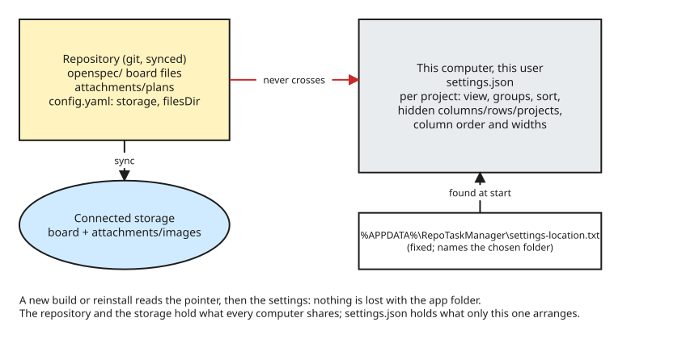

# User settings per machine, per project, in a place the user chooses, 13 Nov 2026

- **Status:** implemented in the working tree, uncommitted; checked in the real app on the hidden desktop (light and dark)
- **Date:** 2026-11-13
- **Author:** Claude (agent, chunk `user-settings`)
- **Work items:** #wi154 "save custom task arrangements" (its note #n245 asks where user-specific data should live)

## Why

"you should store user settings that would persist between builds but that are pointed to separately from project assets. let users select where to store them (not on the cloud - machine specific). for example, if I rearrange columns, hide stuff -> this becomes modified (my order is one aspect of it, but we expand it to per-project view)."

The item's own report: hide what you do not want to see, add items, go around the views, come back to the board, and the hidden list is empty again.

## What was wrong

The arrangement was already saved per project in `%APPDATA%\RepoTaskManager\settings.json` (`BoardOptions` under the repository's key), but the board and the side menu read and wrote it under `Workspace.Root`, the process-wide *active* project. Opening a card or adding an item in another project makes that project active (its item page reads it), so the board silently switched to that project's record: its own, usually empty, hidden list, grouping and view. The first project's record was never lost, which is why it came back after switching tabs. The single-project walk (add an item, list, calendar, item page, board) keeps the hidden list in a test, so that was not the cause. `Workspace.Root` also moves while another project is read in passing (`Workspace.In`), which the view must not follow either.

Fix, in the shared place: `Workspace.ViewRoot`, the project whose saved view the board shows. It changes when the user switches to a project's tab (`OpenTab`), on the first open and when its tab is closed, never by opening or adding an item elsewhere and never by `In`. `SideNav` and `BoardPage` read and save through it.

## What the industry does

Per-machine workspace state is kept apart from what the team shares, and each tool has a different answer to where:

- **VS Code** keeps per-workspace state (open editors, layout, extension state) in the user data directory, `User/workspaceStorage/<workspace id>/state.vscdb`, outside the project folder; the project's own `.vscode/` holds only what is meant to be shared. It is described as transient state, not for critical data. ([VS Code common capabilities](https://code.visualstudio.com/api/extension-capabilities/common-capabilities.md), [community notes on the folder structure](https://lightrun.com/answers/microsoft-vscode-revisit-vs-code-folder-structure-for-app-data-settings-extensions))
- **JetBrains IDEs** put personal settings in `.idea/workspace.xml` and tell teams to keep it out of version control (the IDE adds it to `.gitignore` when VCS is enabled), sharing the other `.idea` files. The pain point users report: shared run configurations then have no clean home. ([Project settings](https://jetbrains.com/help/idea/configure-project-settings.html), [How to manage projects under Version Control Systems](https://intellij-support.jetbrains.com/hc/articles/206544839))
- **Obsidian** keeps layout and open tabs in `.obsidian/workspace.json` inside the vault, which is per-device state: synced vaults produce conflict copies of it and people exclude it from sync; the config folder name can be overridden per device. ([What does workspace.json do?](https://forum.obsidian.md/t/what-does-workspace-json-do/68392), [workspace.json and OneDrive](https://forum.obsidian.md/t/vault-synced-over-onedrive-across-multiple-machines-generates-many-copies-of-workspace-json/115229))

What we take: per-user state lives outside the repository (VS Code), keyed by project, never shared (JetBrains), and never synced (Obsidian's conflict copies). What we add: the user chooses the folder, and a pointer at a fixed place lets a new build find it.

## Decisions

1. User settings stay per machine and per user: never in the repository, never synced, nothing in the cloud. The file keeps its shape.
2. The cleared hidden list is the view following the active project (above), fixed in `Workspace.ViewRoot`.
3. A chosen location: Settings has a "User settings" row with the file's folder, Browse… (the folder picker, now with a title) and Move, which moves `settings.json` to the chosen folder and uses it from then on. The folder is remembered in `settings-location.txt` next to the default file (`%APPDATA%\RepoTaskManager\`), so a new build or reinstall finds it. A pointer that cannot be used (unreadable, not a path, folder or file gone) falls back to the default file and the Settings page says so. No environment override; `RTM_SETTINGS` still means "this exact file, no pointer" for tests and demos.
4. Per project: view, grouping, sort, hidden columns / rows, compact, show hidden, list column order and widths are all `BoardOptions` fields saved under the project's key; hidden and collapsed projects are lists of project keys in the same file. Nothing of this was still per session or per window, so nothing moved. The record stays `BoardOptions`; no parallel store.
5. Moving refuses a folder that already holds a `settings.json` (never overwrites), a folder that does not exist, and a detached window (it only reads).

## Chunks

| Chunk | What | Test | Black-box check |
|---|---|---|---|
| `user-settings` (the only one) | `Workspace.ViewRoot`; `SettingsStore.Open` / `MoveTo` / pointer / notice; Settings row | `KeepingMyArrangementsTests`, `ChoosingWhereUserSettingsLiveTests` | hidden desktop: hide a column, add an item in another project, come back; Settings row, Browse, Move; both themes |

## Verification

- Unit and component tests: the names above; the whole fast suite once.
- Real app on the hidden desktop (`tests/hidden-app.ps1`, `RTM_SETTINGS` and `RTM_HOME` pointing under `tests/out`): screenshots `user-settings-*` in `tests/out/shots/`, light and dark: the Settings row with the location, and the board with a column hidden, an item added in another project and the list visited, then back on the board with the column still hidden.
